# The Older and Wider Podcast

## Overview

Older and Wider is a humorous (and [real](https://shows.acast.com/older-and-wider-podcast)) podcast, where two friends chat and share their day-to-day experiences as older women. It is hosted by retired television producer/writer, Judith Holder, and award-winning comedian, Jenny Eclair.

The website gives information about the podcast. It has an embedded podcast player, the dates of the 2027 live tour, a link to the shop, and access to the Instagram page that the hosts call the "message board". The podcast has had over 7.5 million downloads.

### Redesign

The site had a full redesign in November 2026. The Code Institute coursework submission was in June 2024. This README describes the current site.

The [README as submitted](https://github.com/dvfrancis/older-and-wider/blob/152a9f3/README.md) is in the repository history at commit `152a9f3`. That version describes the site as the assessors saw it.

| Submitted design (June 2024) | Current design (November 2026) |
|---|---|
|  | 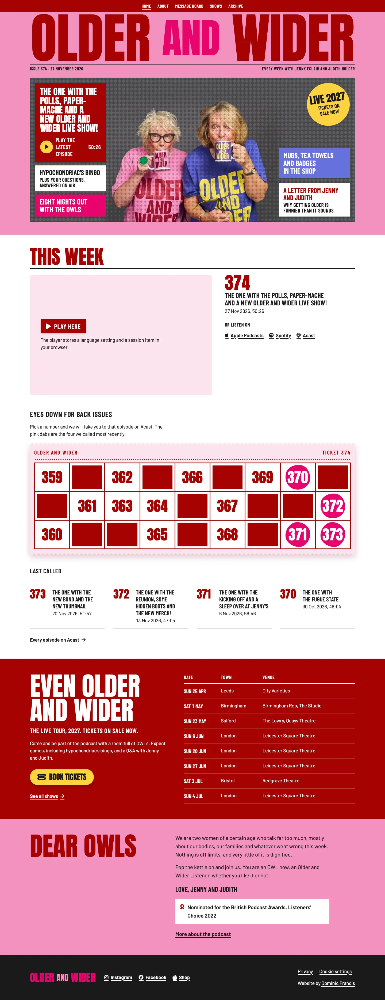 |

### Background Information

There are several references scattered across the site which refer back to items that are regularly mentioned, or discussed, on the podcast:

- Older and Wider Listeners are called OWLs.
- Anyone listening to the podcast is regarded as "part of the gang", or a "gang member".
- Snore Law is invoked by either Jenny or Judith when they feel the conversation has got too boring; this is usually accompanied by a loud snoring noise.
- Jenny and Judith both love coleslaw, and it is mentioned frequently.
- When people contact the podcast, Jenny and Judith insist that people include their age with fractions; for example, "This email is from Sarah who is 59 and three quarters" (the removed contact form used a text input for age for this reason).
- Jenny and Judith have stated that a Breton top is the de facto uniform of an OWL.
- Jenny and Judith regularly refer to the podcast Instagram page as the "message board".
- There are a couple of regular podcast features:
    - Culture corner - Jenny and Judith discuss any books they are reading, television they've enjoyed, visits to art galleries, etc.
    - Taste sensations - Jenny and Judith discuss any amazing meals they may have had in the previous week.

### Site Preview

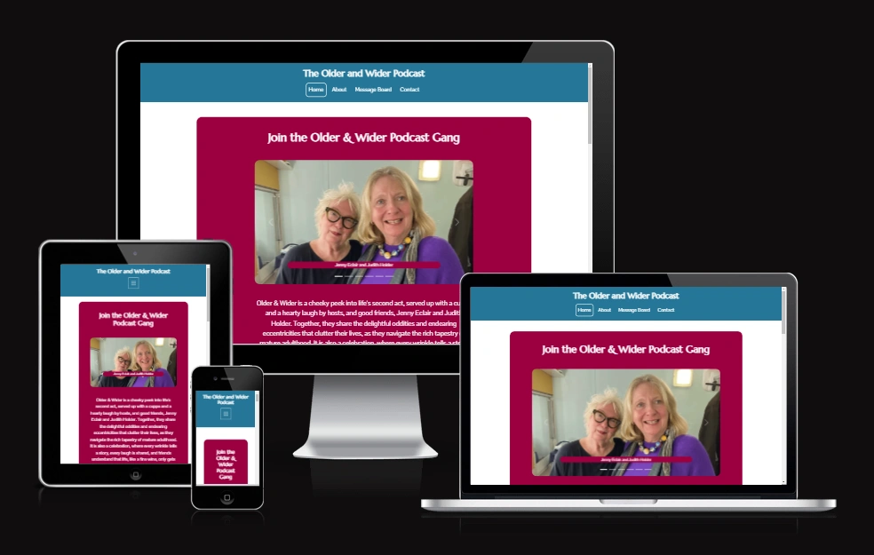

This preview shows the earlier design. The [Screenshots](#screenshots) section shows the new design.

### Site Link

[here]: https://older-and-wider.dominicfrancis.co.uk
The live site can be accessed [here].

## Index

1. [Overview](#the-older-and-wider-podcast)
    1. [Redesign](#redesign)
    2. [Background Information](#background-information)
    3. [Site Preview](#site-preview)
    4. [Site Link](#site-link)
2. [Design](#design)
    1. [Design System](#design-system)
    2. [Screenshots](#screenshots)
    3. [Earlier Design Concepts](#earlier-design-concepts)
3. [User Experience Design](#user-experience-design)
    1. [Strategy](#strategy)
        1. [User Experience](#user-experience)
        2. [User Expectations](#user-expectations)
        3. [User Stories](#user-stories)
    2. [Scope](#scope)
        1. [Existing Features](#existing-features)
        2. [Removed Features](#removed-features)
        3. [Future Features](#future-features)
    3. [Structure](#structure)
        1. [User Flow Diagram](#user-flow-diagram)
    4. [Skeleton](#skeleton)
        1. [Wireframes](#wireframes)
            1. [Mobile](#mobile)
            2. [Mobile with Expanded Menu](#mobile-with-expanded-menu)
            3. [Tablet](#tablet)
            4. [Desktop](#desktop)
    5. [Surface](#surface)
        1. [Colours](#colours)
        2. [Typography](#typography)
        3. [Media](#media)
        4. [Content](#content)
4. [Testing](#testing)
5. [Deployment](#deployment)
    1. [Amazon S3 and CloudFront](#amazon-s3-and-cloudfront)
    2. [Automatic Episode Update](#automatic-episode-update)
    3. [Live Shows Maintenance](#live-shows-maintenance)
        1. [Add a Show](#add-a-show)
        2. [Correct a Show](#correct-a-show)
        3. [Remove a Cancelled Show](#remove-a-cancelled-show)
        4. [Move a Finished Tour to the Archive](#move-a-finished-tour-to-the-archive)
        5. [Add or Correct a Venue](#add-or-correct-a-venue)
    4. [Archive Maintenance](#archive-maintenance)
        1. [Add an Older and Wider Show to the Archive](#add-an-older-and-wider-show-to-the-archive)
        2. [Move a Tour from the Live Shows Page to the Archive](#move-a-tour-from-the-live-shows-page-to-the-archive)
        3. [Add a Solo Tour](#add-a-solo-tour)
        4. [Correct or Remove a Show](#correct-or-remove-a-show)
        5. [Add a Book to Wider Work](#add-a-book-to-wider-work)
        6. [Update the Venue List](#update-the-venue-list)
        7. [Data Sources and Limits](#data-sources-and-limits)
    5. [Instagram Posts](#instagram-posts)
        1. [Add a Post to the Message Board](#add-a-post-to-the-message-board)
        2. [How the Update Works](#how-the-update-works)
        3. [Login Type](#login-type)
        4. [Switch On API Mode](#switch-on-api-mode)
        5. [Token Refresh](#token-refresh)
        6. [Tasks After the First API Run](#tasks-after-the-first-api-run)
    6. [Sitemap and robots.txt](#sitemap-and-robotstxt)
    7. [Forks](#forks)
    8. [Local Clones](#local-clones)
    9. [Gitpod Workspaces](#gitpod-workspaces)
6. [Credits and References](#credits-and-references)
7. [Technologies Used](#technologies-used)
8. [Acknowledgements](#acknowledgements)

## Design

### Design System

The redesign gives the site the look of a weekly magazine. The 2027 tour poster for "Even Older and Wider" sets the colours and the fonts. [DESIGN.md](DESIGN.md) holds the full design system. Read it before you change the look of the site. [PRODUCT.md](PRODUCT.md) holds the product record: the users, the purpose and the brand rules.

The main parts of the design are:

- A pink ground (#F492BF).
- Red (#A60201) for the masthead and the display text.
- The logotype "Older and Wider". The word "and" is magenta (#E8046C), as on the tour poster.
- Three fonts, hosted on the site: Anton for display text, Barlow Condensed for labels, and Barlow for body text.
- A halftone dot screen on the photos, as in a printed magazine.
- A magazine cover on the home page, with an issue line and cover lines.
- A bingo ticket on the home page that leads to back issues of the podcast.
- A table of the dates of the 2027 tour.
- A letter to the listeners, "Dear OWLs", from Jenny and Judith.

The show name is "Older and Wider". The site does not use an ampersand in the name.

### Screenshots

The screenshots show the live site on 28 November 2026, in Safari's engine (WebKit). The phone width is 390 px. The desktop width is 1440 px.

| Page | Phone | Desktop |
|---|---|---|
| Home | [Phone](documentation/screenshots/phone-index.webp) | [Desktop](documentation/screenshots/desktop-index.webp) |
| About | [Phone](documentation/screenshots/phone-about.webp) | [Desktop](documentation/screenshots/desktop-about.webp) |
| Message Board | [Phone](documentation/screenshots/phone-message-board.webp) | [Desktop](documentation/screenshots/desktop-message-board.webp) |
| Shows | [Phone](documentation/screenshots/phone-live-shows.webp) | [Desktop](documentation/screenshots/desktop-live-shows.webp) |
| Archive | [Phone](documentation/screenshots/phone-archive.webp) | [Desktop](documentation/screenshots/desktop-archive.webp) |
| Privacy | [Phone](documentation/screenshots/phone-privacy.webp) | [Desktop](documentation/screenshots/desktop-privacy.webp) |
| 404 | [Phone](documentation/screenshots/phone-404.webp) | [Desktop](documentation/screenshots/desktop-404.webp) |
| Cookie banner | [Phone](documentation/screenshots/phone-consent-banner.webp) | [Desktop](documentation/screenshots/desktop-consent-banner.webp) |

The home page on a phone:


The home page on a desktop:


### Earlier Design Concepts

The folder `design-options/` holds five earlier design concepts:

- `bingo`
- `magazine`
- `pier-show`
- `step-row`
- `variety-bill`

The project keeps them for reference. The build script does not deploy them. The live design develops the magazine concept.

## User Experience Design

### Strategy

#### User Experience

- Target audience

    - Women over 60 (but anyone welcome).
    - Are mature individuals, with lots of life experience.
    - May have children and grandchildren.
    - Might still be working or retired.
    - Could be anyone looking for information about the podcast.
 
#### User Expectations

- An accessible and responsive website.
- Relevant information that is easily found.
- Simple website navigation.
- A way to get in touch with the podcast, to share experiences.
- An experience that matches existing expectations of what to expect from a website; for example, links are easy to identify and function as expected.
- An appealing visual design.

#### User Stories

- First time visitor goals:

    - "What is the Older and Wider podcast about?"
    - "Who is Jenny Eclair?"
    - "Who is Judith Holder?"
    - "Where can I listen to the Older and Wider Podcast"
    - "When are episodes of the Older and Wider podcast released?"

- Returning visitor goals:

    - "I want to find out more background information about the Older and Wider podcast"
    - "What was mentioned during the 'Culture Corner' segment of this week's show?"
    - "Has the podcast won any awards?"
    - "What is the 'Message Board' - it was mentioned by Jenny and Judith in this week's episode, but where can I access it?"

- Frequent visitor goals:

    - "How can I contact Jenny and Judith to share my experiences, or comment on an item that was mentioned in the show?"
    - "Is there any podcast merchandise available?"
    - "Can I watch the podcast being performed live?"

### Scope

#### Existing Features

- General

    - Each page is responsive. The layout changes at 48rem (768px) and at 64rem (1024px).
    - Each page works without JavaScript.
    - The site has seven pages: Home, About, Message Board, Shows, Archive, Privacy and a custom 404 page.
    - No third-party embed loads until the visitor asks for it. Google Analytics loads only after the visitor accepts analytics cookies.
    - Each link to another website opens in a new tab. The link has the attributes `rel="external noopener" target="_blank" aria-describedby="new-tab"`.
    - The footer of each page holds a hidden element `<span id="new-tab" hidden>Opens in a new tab</span>`. Screen readers read this text with each external link.
    - The screenshots in this section show the earlier design. New screenshots of the redesign are to be added.

- Browser Tab Icon:

    - A custom favicon helps users to identify the site. It also shows when a user adds the site as a bookmark or favourite.
    - The favicon shows OLDER, AND and WIDER on three lines, as on the merchandise. AND is smaller and in magenta.
    - The site has a multi-size `.ico` file (16, 32 and 48 pixels), a 192 pixel PNG and a 180 pixel Apple touch icon.
    - A copy of the `.ico` file is at the root of the site as `favicon.ico`. Some browsers and crawlers ask for that address directly.

        

- Header:

    - The header is a strip at the top of each page. It holds the main navigation.
    - The navigation has five links, in this order: Home, About, Message Board, Shows and Archive. The "Shows" link opens `live-shows.html`.
    - On phones the links are a little smaller, so that the five links fit on one row at 375 pixels wide.
    - The link to the current page has the attribute `aria-current="page"`. This attribute tells screen readers which page is open.
    - The header as it appeared on desktops in the earlier design:

        

    - The header as it appeared on mobile in the earlier design:

        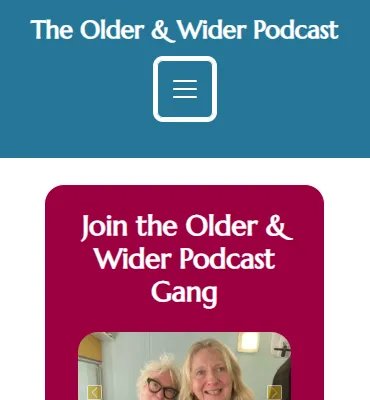

    - and with the expanded hamburger menu of the earlier design:

        

- Footer:

    - The footer is at the bottom of each page. It shows the logotype "Older and Wider".
    - It has links to Instagram, Facebook and the shop at [olderandwider.shop](https://olderandwider.shop).
    - It has a credit link to the author of the website.
    - It has a "Privacy" link to `privacy.html`, and a "Cookie settings" button. The button opens the cookie banner again.
    - The "Cookie settings" button is hidden without JavaScript, because it needs `assets/js/consent.js`.
    - The footer as it appeared in the earlier design:

        

- Home (index):

    - The home page looks like the cover of a weekly magazine. It has these sections:
        - Cover: the masthead, an issue line with the episode number and the date, a halftone photo of the hosts, and cover lines. Each cover line links to a section of the page or to the shop. "Hypochondriac's bingo" links to the bingo ticket of back issues.
        - This week: a "Play here" button for the latest episode, and links to Apple Podcasts, Spotify and Acast. The Acast player loads only when the visitor presses the button. A note next to the button tells the visitor that the player stores a language setting and a session item in the browser. The site does not remember this choice, so the button shows on each visit. The script `assets/js/player.js` does this work. Without JavaScript, the button is replaced by a "Listen on Acast" link.
        - Back issues: a bingo ticket. Each number on the ticket links to its own episode on Acast. A "Last called" list shows the four previous episodes.
        - The episode content updates automatically each Friday from the podcast RSS feed. Refer to [Automatic Episode Update](#automatic-episode-update).
        - Tour: "Even Older and Wider", the 2027 live tour. A table shows the eight dates, towns and venues. The "Book tickets" link opens the ticket page. The "See all shows" link opens `live-shows.html`.
        - Letter: "Dear OWLs", a letter from Jenny and Judith, with the award nomination.
    - The home page as it appeared in the earlier design:

        

- About:

    - The about page gives information about the podcast and the two hosts. It has these sections:
        - What is Older and Wider? This section tells the history of the podcast. It gives the number of downloads (over 7.5 million) and the award nomination.
        - Who is Judith Holder? A biography, with a contact sheet of more photos.
        - Who is Jenny Eclair? A biography, with a contact sheet of more photos.
        - Hear them for yourself: links to the latest episode and to every episode on Acast.
    - The about page as it appeared in the earlier design:

        

- Live Shows:

    - The page `live-shows.html` lists the live shows of the current tour. It has these sections:
        - Intro: the page title, a short text and the 2027 tour poster. The poster has alt text, and each date on it is also on the page as text.
        - Forthcoming shows: white text on the red of the poster dates panel. Each show gives the date with the day of the week and the year, the town or city, the venue, the tour name and a ticket link. The earliest show is first.
        - Recent shows: the shows of the current tour that are in the past. The latest show is first. Past shows have no ticket link.
        - The venues: Ink text and white cards on Soft Pink. The section has one list item for each venue. Each item gives these data:
            - The name of the venue and the town or city.
            - The postal address.
            - A link to the website of the venue.
            - A link to the access information of the venue, if the venue publishes it.
            - The dates of the Older and Wider shows at the venue, each in a `time` element.
    - The venue text of each show is a link to the venue item, for example `<a href="#venue-city-varieties">`. The link stays in the show when the script moves the show to Recent shows.
    - Each venue item also lists the earlier Older and Wider shows at the venue, under the label "Past shows". The Theatre at the Tabard has no show in the 2027 tour, so it lists past shows only.
    - Latitude Festival (2021) and Hebden Bridge Arts Festival (2019) also have items. Both dates are uncertain. The Hebden Bridge Arts Festival has no website now, so its item has no links.
    - Each address and access link comes from the website of the venue. The Lowry and the Theatre at the Tabard block automated requests. The address of The Lowry comes from a technical specification on its website. The address of the Tabard comes from search results on its domain. A person checked the access links of The Lowry and the Tabard in a browser.
    - Each date is in a `time` element with a `datetime` attribute, for example `datetime="2027-04-25"`.
    - Each ticket link names the show, for example "Tickets for Leeds, 25 April". The link opens the ticket page of the venue. The Bristol show is not on sale yet, so its link opens [jennyeclair.com/olderandwider](https://jennyeclair.com/olderandwider).
    - The poster gives the last London show as "SAT 04 JUL". The Leicester Square Theatre website gives Sunday 4 July 2027. The page uses the date from the theatre and tells the visitor about the error on the poster.
    - The script `assets/js/live-shows.js` moves each past show to Recent shows when the page loads. It does these steps:
        1. It gets the date of today in the time zone `Europe/London`. The time zone of the visitor has no effect.
        2. It reads the `datetime` of each forthcoming show.
        3. It moves each show with a date before today to Recent shows, in order with the latest date first.
        4. It removes the ticket link from each show that it moves.
        5. It shows the message of each list that is empty, and hides the empty list.
    - A show stays in Forthcoming shows for all of the day of the show. It moves on the next day.
    - Without JavaScript, each show stays in the section where the HTML has it. A past show can then stay in Forthcoming shows, with its ticket link. No show is lost. To limit this, move the past shows in the HTML each time you edit the page.
    - Refer to [Live Shows Maintenance](#live-shows-maintenance) for the procedures that stay manual.

- Archive:

    The archive page, `archive.html`, has four sections:

    1. Jenny and Judith's shows. This section has these parts:
       - "Older and Wider live". This table shows each show with both hosts, with the latest show first.
       - "Grumpy Old Women". This part has a list of the stage shows that Jenny and Judith wrote together, and the seasons in Australia.
    2. Jenny's solo shows. This section has these parts:
       - "Coming up". This part shows a message and a link to `jennyeclair.com` when no solo show is on sale.
       - "Earlier tours". This part has a list of the tours and the Edinburgh shows, with the latest show first.
    3. Wider work. This section lists the books, television and radio of each host. Each item has a link to its source. Where possible, an item also links to the work itself. A book links to its page on Amazon UK, and a television or radio series links to its page on BBC Programmes or Channel 4. Most books show a cover from Open Library. The covers of The Book of Nanas and Jokes, Jokes, Jokes come from Hachette UK, the publisher. The site keeps a copy of each cover in `assets/images/covers/`.
    4. Venues. A closed `details` element lists every venue in the archive and every show on `live-shows.html`, which includes the 2027 tour. The visitor opens the list to see it. The list has these parts:
       - A search box. The visitor types a town, a county, a venue, a show or a year. The list shows only the towns that match. The map shows the matching towns in red. If the text matches a show or a date, the show list of the venue opens. The script `assets/js/archive-venues.js` does this work. Without JavaScript, the search box does not show.
       - Two buttons, "Open all letters" and "Close all letters". Without JavaScript, the buttons do not show.
       - A map of the UK, Ireland and the Channel Islands. Each town is a dot. A bigger dot shows more shows. The towns in Australia are not on the map. A note under the map names them.
       - One closed `details` element for each first letter. Each letter lists its towns. Each town shows its county and its venues, with the number of shows at each venue.
       - The number of shows at each venue is a closed `details` element. When it opens, it lists each show at the venue, with the date and the show name. The latest show is first. The show name of a tour date is the name of its tour.
       - A link to the website of each venue, if the venue has a website. Each link opens in a new tab.

       The script `scripts/update_archive_venues.py` builds the list. Refer to [Update the Venue List](#update-the-venue-list).

    Each show in a list is a white card. A show with dates is a `details` element. When it opens, it shows a short text about the show, an optional note and the table of dates. A show with no single dates, for example an Edinburgh show, is a plain card that does not open. The paragraph above each list gives the total number of dates in the list. The seasons in Australia are not in the total.

    Each date is in a `time` element with a `datetime` attribute. If only the month is known, the attribute has the form `YYYY-MM`.

    A "Back to top" link is fixed to the bottom right of the window. It opens `#top`, the `id` of the page header. The link needs no JavaScript. In a browser that supports scroll-driven animation, the link shows only after the first screen.

    The page has one script of its own, `assets/js/archive-venues.js`, for the venue search. All the content shows without JavaScript.

- Message Board:

    - The hosts call the podcast's Instagram page the "message board". This page links to it, and to the Facebook page.
    - An issue line under the title shows "Message board" and the date of today. The script `assets/js/board-date.js` adds the date. Without JavaScript, the issue line shows "Message board" only.
    - A halftone print of a mirror selfie of Jenny and Judith sits next to the title.
    - The page shows up to ten recent Instagram posts as short text quotes or summaries, with their dates and links. No content loads from Instagram when the page opens. The section [Instagram Posts](#instagram-posts) tells how the list updates.
    - The button "Show the posts here" loads the full Instagram posts. The note next to the button tells the visitor that Instagram then sets cookies.
    - The script `assets/js/message-board.js` does this work. Without JavaScript, the text and the links still work.
    - The message board page as it appeared in the earlier design:

        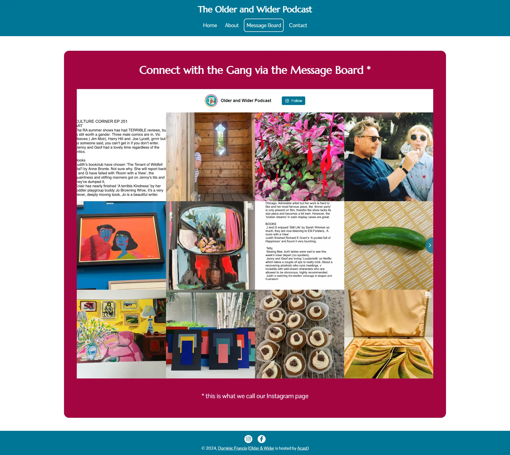

- Privacy:

    - The privacy page `privacy.html` tells the visitor that the site has no forms and collects no personal data directly.
    - A table shows each third party, what it stores, and when. The third parties are the Acast player, Instagram, Google Analytics and Font Awesome from cdnjs.
    - The page tells the visitor how to change or withdraw consent, with the "Cookie settings" button.
    - It names the controller, Dominic Francis, with a link to his website. It shows no email address.
    - The page has no link in the navigation. The footer of each page links to it.

- Cookie consent and analytics:

    - On the first visit, a banner at the bottom of the window asks about analytics cookies only. The "Accept" and "Reject" buttons have the same size, colour and weight.
    - The script `assets/js/consent.js` makes the banner. It stores the choice in `localStorage`, under the key `oaw-consent`, with the date.
    - The banner does not trap focus. It sits after the footer in the page, and sticks to the bottom of the window.
    - "Reject" deletes the `_ga` and `_ga_*` cookies for the current host and its parent domains.
    - The script `assets/js/analytics.js` loads Google Analytics only when the stored choice is "accepted". It listens for the event `oaw:consentchange` from `consent.js`. Thus "Accept" loads Google Analytics without a reload.
    - Without JavaScript, the banner does not show, and no analytics load.
    - The constant `GA_MEASUREMENT_ID` at the top of `assets/js/analytics.js` holds the GA4 ID `G-KQEX5744PM`. dominicfrancis.co.uk uses the same ID. Filter GA4 reports by the hostname `older-and-wider.dominicfrancis.co.uk` to see this site alone.

- Custom 404:

    - A custom 404 error page shows when a user goes to a page that does not exist.
    - The page uses the humour of the podcast ("Snore Law has been invoked"). It links to the latest episode and to the home page.
    - The page does not redirect. The earlier design redirected to the home page after 30 seconds.
    - The page uses root-relative links, so it works at any address.
    - The 404 page as it appeared in the earlier design:

        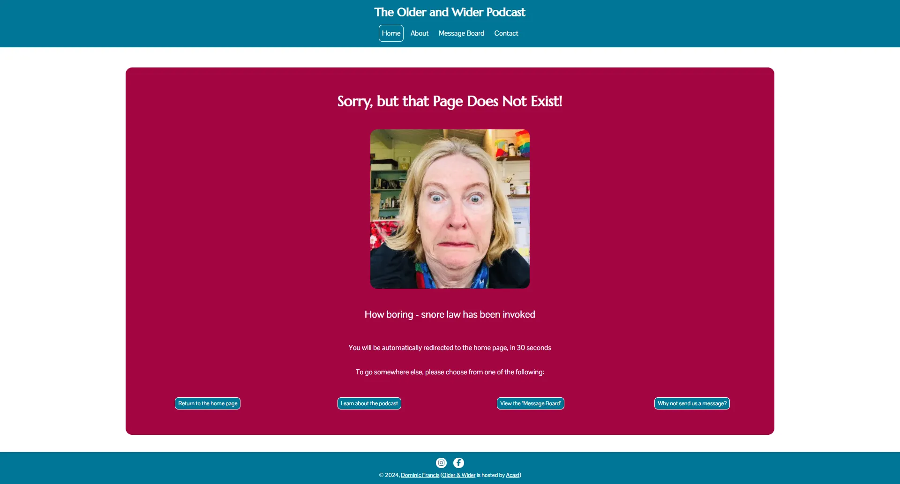

#### Removed Features

The redesign removed these pages and features:

- The mailing list form on the home page, and its completion page `mailing-list-completion.html`.
- The contact page `contact.html`, with its contact form, and its completion page `contact-completion.html`.
- The "Contact" link in the navigation.
- The image carousels on the home page and the about page.
- The Bootstrap framework.

The forms had no backend. They did not send data to the hosts. A mailing list is deferred until the site has run for some time. Issue #30 holds the plan.

#### Future Features

- The addition of a website forum would allow fans of the podcast to interact, discuss the show, and share their life experiences.
- A mailing list, if the hosts want one after the site has run for some time (issue #30).

### Structure

#### User Flow diagram

This diagram shows how the user may interact and navigate through the website; dashed lines indicate optional routes.

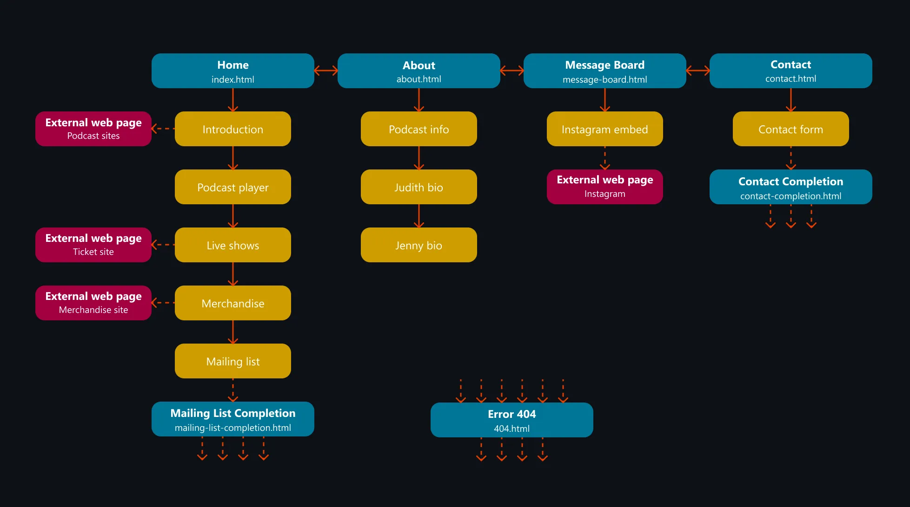

### Skeleton

#### Wireframes

After I created the wireframes, and was bulding the site, I altered the layout of the header and footer so that the logo was replaced by a centred site title in the header but removed from the footer.

The hamburger menu (shown in the header on smaller mobile devices) was also centred on the screen.

The wireframes presented here show my initial ideas. They show the first design, before the redesign. The redesign removed three of these pages. Their headings below are marked "(page removed)".

##### Mobile

###### Home
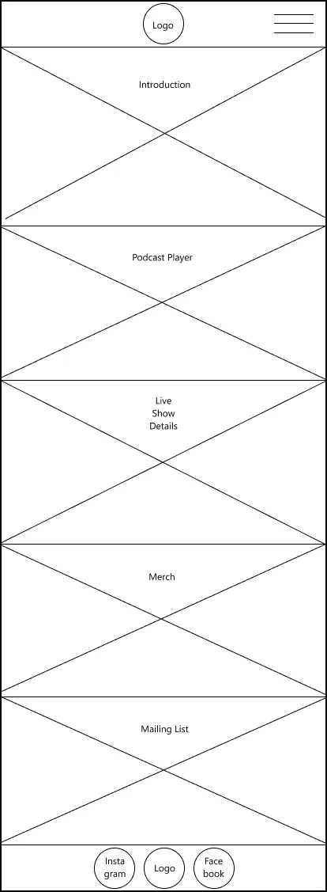
###### Mailing List Completion (page removed)
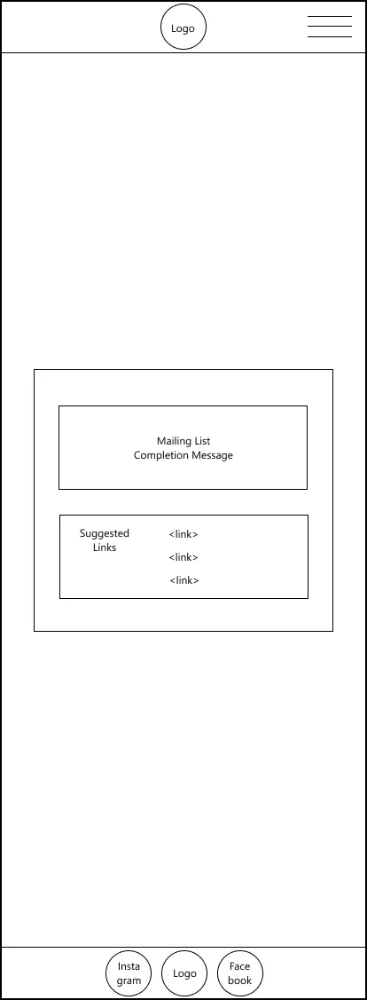
###### About

###### Message Board

###### Contact (page removed)

###### Contact Completion (page removed)

###### Custom 404


##### Mobile (with expanded menu)

###### Home
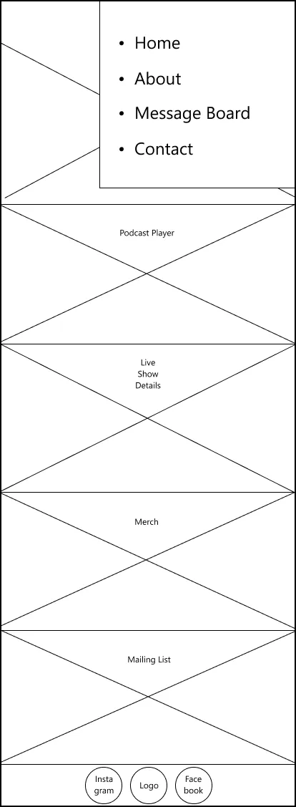
###### Mailing List Completion (page removed)

###### About

###### Message Board
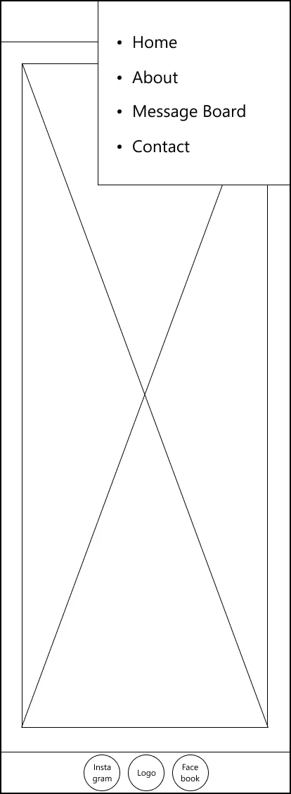
###### Contact (page removed)
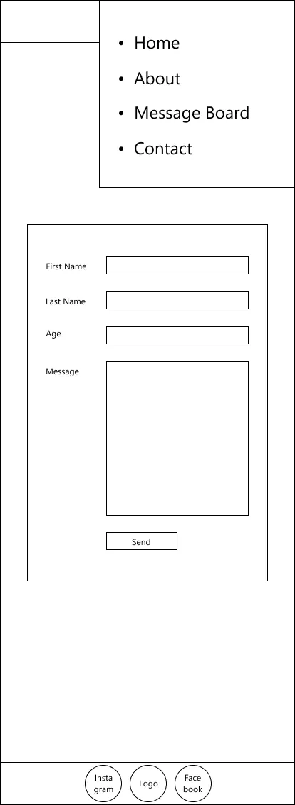
###### Contact Completion (page removed)
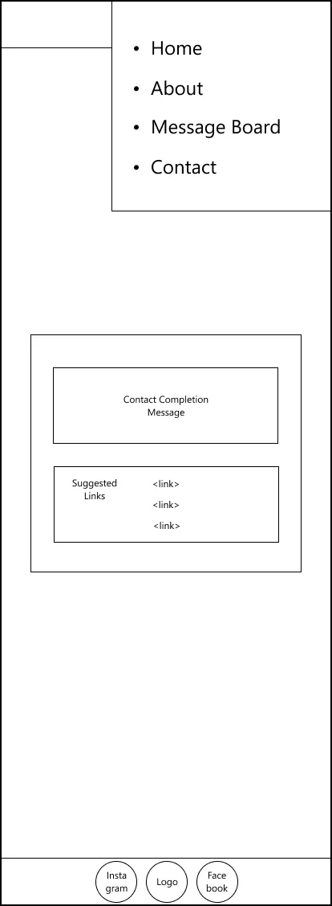
###### Custom 404


##### Tablet

###### Home

###### Mailing List Completion (page removed)

###### About
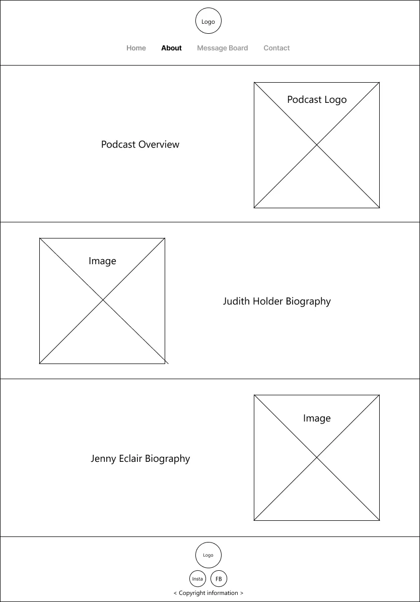
###### Message Board

###### Contact (page removed)

###### Contact Completion (page removed)
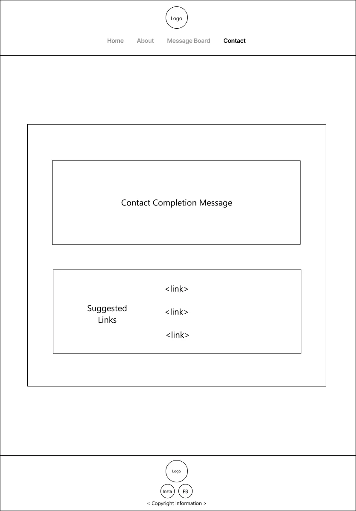
###### Custom 404


##### Desktop

###### Home

###### Mailing List Completion (page removed)

###### About
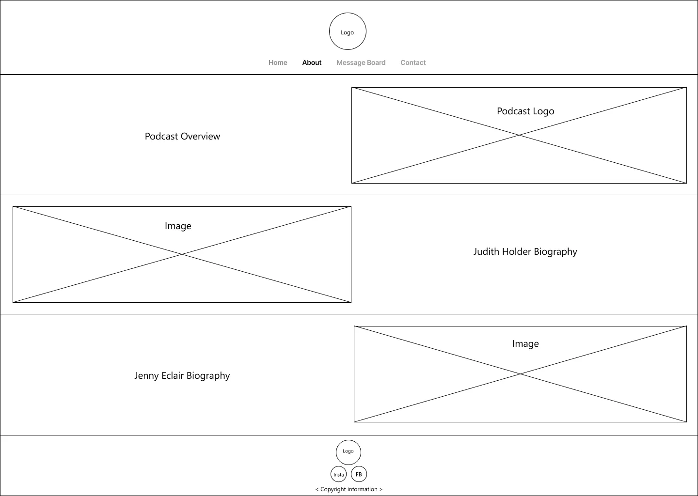
###### Message Board
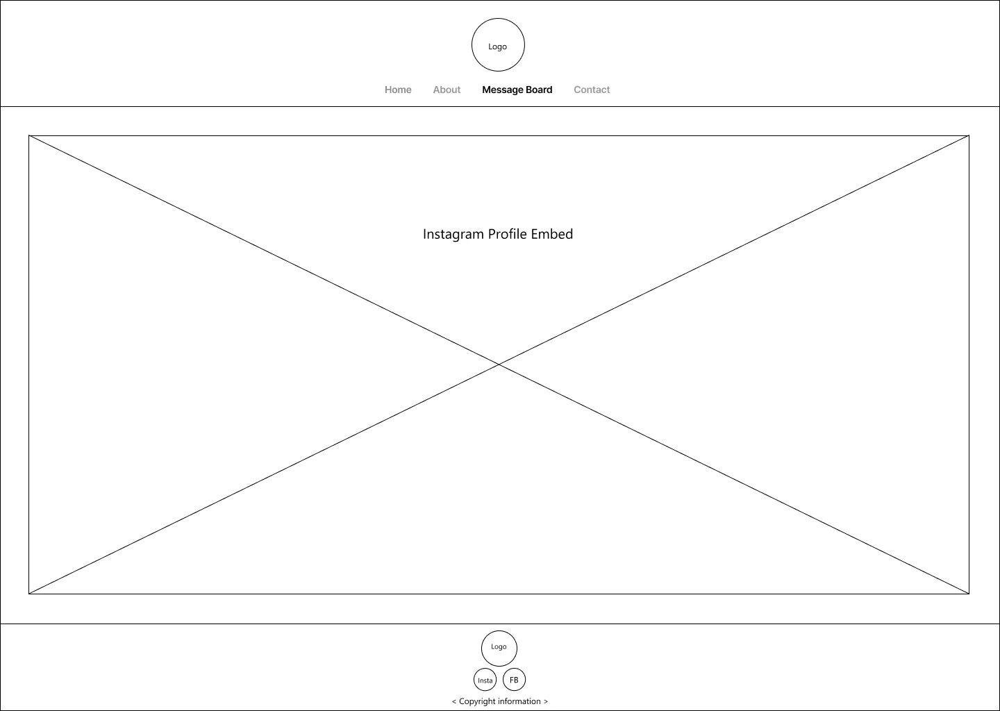
###### Contact (page removed)

###### Contact Completion (page removed)

###### Custom 404


### Surface

#### Colours

The colours come from the 2027 tour poster. [DESIGN.md](DESIGN.md) gives the full palette, the rules for each colour, and the contrast figures. The main colours are:

- Pink (#F492BF): the page ground.
- Red (#A60201): the masthead and the display text.
- Magenta (#E8046C): the word "and" in the logotype.

The stylesheet defines each colour as a CSS custom property in `:root`, for example `--pink`.

The earlier design used palette 389 of the [Sarah Renae Clarke Colour Catalogue, Volume 2](https://sarahrenaeclark.com/shop/the-color-catalog-volume-2/), with teal and raspberry. The redesign replaced it.

#### Typography

The fonts come from the 2027 tour poster. The site hosts the font files in `assets/fonts/`. Each page preloads Anton, Barlow 400 and Barlow Condensed 600. This stops the layout shift that occurred when the fonts loaded from Google Fonts:

- [Anton](https://fonts.google.com/specimen/Anton) for the masthead and the display text.
- [Barlow Condensed](https://fonts.google.com/specimen/Barlow+Condensed) for labels.
- [Barlow](https://fonts.google.com/specimen/Barlow) for body text.

The earlier design used Marcellus and Pontano Sans. The redesign replaced them.

#### Media

All images used on the site have been taken from the Older and Wider podcast [Instagram](https://www.instagram.com/olderandwiderpodcast) page, the [shop](https://olderandwider.shop), and the 2027 tour poster.

The stylesheet puts a halftone dot screen on the photos, so that they look like print in a magazine.

Each photo has fixed-width variants (for example `_256.webp`, `_480.webp` and `_800.webp`). The HTML `img` `srcset` and `sizes` attributes select the correct variant for the screen. I used [RespImageLint](https://ausi.github.io/respimagelint/) to advise about these variants.

#### Content

All page content was initially written by myself, inspired by the sources listed in the credits, and then polished using Copilot in Microsoft Edge.

## Testing

- Please refer to [TESTING.md](TESTING.md) for details.

## Deployment

### Amazon S3 and CloudFront

The site is stored in an Amazon S3 bucket, and served through Amazon CloudFront, in the `eu-west-2` region. The bucket is `portfolio-dominicfrancis`. It holds more than one site. Each site has its own folder, and this site uses the folder `older-and-wider`. CloudFront reads that folder through an origin path. Thus the address of each page stays the same. Deployment is automatic. Each push to the `main` branch that changes a page, an asset, or the build script publishes the site again. The weekly episode update also publishes the site. Refer to [Automatic Episode Update](#automatic-episode-update).

Three files do this work, and are easier to understand together:

- `build.sh` assembles the site into a `deploy/` directory, and then copies it to the site folder in the bucket. It copies only the pages and directories in its list. Thus an unwanted file in the repository root cannot go live by accident. Git does not track `deploy/`, and the script makes it again on each run.
- `.github/workflows/deploy.yml` runs the command `./build.sh --deploy --yes` on each push to the `main` branch that changes `*.html`, `assets/**`, `build.sh`, or the workflow file. GitHub Actions runs the same script that you run on your own computer. Thus the two cannot become different. Another workflow can also call this workflow (`workflow_call`). The episode update workflow uses this trigger.
- `infra/deploy-role.yaml` is the CloudFormation template for the role that the workflow uses. The role trusts only the `main` branch of this repository. Its permissions apply only to this site's folder, and to the one distribution. The role cannot read or delete the folder of another site. No Amazon Web Services keys are kept in the repository, or in GitHub.

To assemble the site on your own computer, but not deploy it, run the command `./build.sh` in the repository root.

Two details are important before you change any of this:

- The cache headers remove the necessity for a cache invalidation step. The script uploads the assets with a one year `max-age`, and the mark `immutable`. It uploads the pages with `no-cache`. CloudFront obeys these headers. Thus a new deployment becomes visible immediately.
- The script adds a hash to the name of each CSS and JS file in `deploy/`, for example `main.bea7c67fec.css`. It changes the links in each page to match. A changed file gets a new name. Thus returning visitors do not keep an old copy from the one-year cache. The build stops if a page links to a file without a hash.
- The deploy workflow also runs when `sitemap.xml`, `robots.txt` or `favicon.ico` changes.
- The script uploads the pages last, after the assets. Thus a live page cannot refer to an asset that is not yet in the bucket.

To add a new page, you must do two steps. It is not sufficient to make the file in the repository root. You must also add the name of the file to the `PAGES` list in `build.sh`. If you do not, the site will never include that page.

The `PAGES` list contains these files:

- `index.html`
- `about.html`
- `message-board.html`
- `404.html`
- `privacy.html`
- `sitemap.xml`
- `robots.txt`
- `favicon.ico`

The `DIRS` list contains only `assets`. Thus the script does not deploy `design-options/` or `documentation/`. The redesign removed `contact.html`, `contact-completion.html` and `mailing-list-completion.html` from the list.

### Automatic Episode Update

The home page shows the latest episode and the 15 episodes before it. A GitHub Action keeps this content up to date. The hosts do not need to do any work.

The parts that update are these:

- The issue line in the masthead, for example "Issue 374 · 27 November 2026".
- The cover headline and the duration of the latest episode.
- The "This week" number, title, date and duration.
- The bingo ticket. It shows the 15 episodes before the latest episode. The 4 newest of these have a pink dab.
- The ticket serial ("Ticket 374").
- The "Last called" list. It shows the 4 episodes before the latest episode, newest first.

These files do the work:

- `scripts/update_episodes.py` reads the Acast RSS feed. It changes only the text between the episode marker comments in `index.html`, for example `<!-- episodes:masthead:start -->`. The script uses the Python standard library only.
- `.github/workflows/update-episodes.yml` runs the script each Friday at 06:17 and 18:17 UTC. You can also start it manually from the Actions tab in GitHub.
- `scripts/test_update_episodes.py` contains the tests. The workflow runs the tests before the script.

The workflow does these steps:

1. It runs the tests.
2. It runs the script against the live feed.
3. If `index.html` changes, it commits `index.html` and `sitemap.xml` to `main` as "chore: update the home page for episode N". It rebases the commit on `main` before the push, because `main` can move while the job runs.
4. It calls `deploy.yml` to publish the commit.

If `index.html` does not change, the workflow stops after step 2.

A push from the `GITHUB_TOKEN` of a workflow does not start other workflows. Thus step 4 calls `deploy.yml` directly. The called workflow runs on `refs/heads/main`, so the deploy role trusts it.

The script obeys these rules:

- It takes the episode number from the `itunes:episode` field. If that field is missing, it uses the prefix of the title, for example "Ep 374.".
- A title prefix must start with "Ep" or "Episode". A title such as "2027: the tour" does not give a number.
- It puts the episodes in number order. The latest episode is the highest number.
- It skips a second item with the same number, for example a repost of an old episode.
- It removes the number prefix from the title on the page.
- If the newest episode has no number, the script stops. It does not change the page.
- It skips an older item that has no number, for example a "sick note" week.
- If the feed does not load or does not parse, the script stops. It does not change the page.
- If the feed has fewer than 16 numbered episodes, the script stops. It does not change the page.
- It links each bingo number to the page of its episode on Acast.
- It keeps the bingo layout. The 15 numbers go up column by column. Each row has five numbers and four blanks.
- When `index.html` changes, it sets the `lastmod` date of the home page in `sitemap.xml` to the date of the latest episode.

The start time of 06:17 UTC is after the usual release time of an episode. The feed shows a release at about 02:00 to 04:00 UTC each Friday. The run at 18:17 UTC catches an episode that comes out late.

Do not edit the text between the episode markers by hand. The next run replaces it.

To see the change that the script would make, run this command in the repository root:

```bash
python3 scripts/update_episodes.py --check
```

The command shows a diff. It does not change the page. It exits with code 1 if the page would change.

To update the page on your own computer, run this command:

```bash
python3 scripts/update_episodes.py
```

To use a local feed file, add `--feed` and the path of the file.

### Live Shows Maintenance

The script `assets/js/live-shows.js` moves past shows. Other changes to `live-shows.html` are manual. Each show is one `li` element in the list `shows-forthcoming` or the list `shows-recent`. A forthcoming show has this form:

```html
<li class="show">
    <p class="show-date"><time datetime="2027-04-25">Sunday 25 April 2027</time></p>
    <h3 class="show-place">Leeds</h3>
    <p class="show-venue"><a href="#venue-city-varieties">City Varieties</a></p>
    <p class="show-tour">Even Older and Wider</p>
    <p class="show-tickets"><a href="https://leedsheritagetheatres.com/whats-on/even-older-and-wider-2027/" rel="external noopener" target="_blank" aria-describedby="new-tab">Tickets for Leeds, 25 April</a></p>
</li>
```

After each change, do these steps:

1. Validate `live-shows.html` with the W3C Markup Validator.
2. Open the page in a browser. Make sure that each show is in the correct section.
3. Change the `lastmod` date of `live-shows.html` in `sitemap.xml`.
4. Push the change to a branch, and merge it to `main` with a pull request.

#### Add a Show

1. Get the date, the town or city, the venue and the ticket address from the venue or from [jennyeclair.com](https://jennyeclair.com/olderandwider).
2. Make sure that the day of the week agrees with the date.
3. Copy one `li` element in the list `shows-forthcoming`.
4. Put the copy in date order. The earliest show is first.
5. Set the `datetime` attribute to the date in the form `YYYY-MM-DD`.
6. Write the date in the `time` element with the day of the week and the year.
7. Change the town or city, the venue and the tour name.
8. Set the `href` of the ticket link to the ticket page of the show.
9. If the show has no ticket page, use `https://jennyeclair.com/olderandwider`.
10. Change the link text to "Tickets for" and the town and date, for example "Tickets for Leeds, 25 April".
11. If the home page shows the tour, add the show to the table in the `tour` section of `index.html`.

A solo tour of Jenny Eclair has more dates than an Older and Wider tour. Do these steps for each date of a solo tour.

#### Correct a Show

1. Find the `li` element of the show.
2. If the date changes, change the `datetime` attribute and the text of the `time` element.
3. Move the `li` element to keep the date order.
4. If the venue changes, change the venue text and the ticket address.
5. Change the link text if the town or the date changes.
6. Make the same change in the `tour` section of `index.html`.

#### Remove a Cancelled Show

1. Find the `li` element of the show.
2. Delete the `li` element.
3. Delete the row of the show from the table in the `tour` section of `index.html`.
4. If the list `shows-forthcoming` is then empty, leave the empty `ol` element in the page. Add the attribute `hidden` to it.
5. Remove the attribute `hidden` from the message `forthcoming-empty`.

Do not move a cancelled show to Recent shows. Recent shows holds only the shows that occurred.

#### Move a Finished Tour to the Archive

Do these steps after the last show of a tour.

1. Copy each show of the tour to the part "Older and Wider live" of `archive.html`.
2. Put the latest show first.
3. Remove the ticket link from each copied show.
4. Check each show against a reliable source, for example a podcast episode after the date. Do not copy a show that did not occur.
5. Delete the shows of the tour from `live-shows.html`.
6. Add the attribute `hidden` to each empty list in `live-shows.html`.
7. Remove the attribute `hidden` from the message of each empty list.
8. Add the shows of the next tour, if one is announced. Refer to [Add a Show](#add-a-show).
9. Change the poster and its alt text in `live-shows.html` for the next tour. Make the `_480` and `_800` width variants of the new poster.
10. Change the `lastmod` dates of `live-shows.html` and `archive.html` in `sitemap.xml`.

#### Add or Correct a Venue

Each venue is one `li` element with the class `venue` in the list `venues`. Get each fact from the website of the venue.

1. Find the `li` element of the venue. To add a venue, copy one `li` element.
2. Give the new `li` element a unique `id` that starts with `venue-`, for example `venue-city-varieties`.
3. Write the name of the venue in the `h3` element. Write the town or city in the `venue-place` paragraph.
4. Write the postal address in the `venue-address` paragraph. Put a `br` element between the lines.
5. Set the `href` of the website link to the home page of the venue.
6. Set the `href` of the access link to the access page of the venue.
7. If the venue has no access page, delete the access link.
8. Add each Older and Wider date at the venue to the list `venue-dates`. Use a `time` element for each date.
9. Make the venue text of each show at the venue a link to the `id`, for example `<a href="#venue-city-varieties">`.
10. Make sure that each `#venue-` link agrees with an `id` on the page.
11. Do not copy text or photos from the website of the venue.

### Archive Maintenance

After each change to a show table in `archive.html`, update the venue list. Refer to [Update the Venue List](#update-the-venue-list).

#### Add an Older and Wider Show to the Archive

1. Make sure that a podcast episode or a venue listing confirms the show.
2. Open `archive.html`.
3. Find the table with the class `arc-shows` in the part "Older and Wider live". This part is in the section "Jenny and Judith's shows".
4. Add a new `tr` element in the correct position. The latest show is first.
5. Put the date in a `time` element. Use the form `YYYY-MM-DD`.
6. If only the month is confirmed, use the form `YYYY-MM`. Write the month and the year only.
7. Add the source to the paragraph of sources below the table, if the source is new.
8. If the exact date is not confirmed, add `<span class="arc-tbc">Date uncertain</span>` after the `time` element.
9. If the venue is also not confirmed, write "Date and venue uncertain" in the span, and "Venue uncertain" in the venue cell.
10. Remove the span when a source confirms the date.

#### Move a Tour from the Live Shows Page to the Archive

Follow the procedure [Move a Finished Tour to the Archive](#move-a-finished-tour-to-the-archive).

#### Add a Solo Tour

A solo tour has many more dates than an Older and Wider tour. You must add the dates by hand.

1. Add a new `li` element to the list with the class `arc-tour-list`, below "Earlier tours". The latest tour is first.
2. In the `li` element, add a `details` element with the class `arc-tour` and a unique `id`, for example `dates-new-tour`.
3. In the `summary` element, give the name of the tour, the years and the number of dates.
4. Below the `summary` element, add a paragraph with the class `arc-tour-about`. Write a short text about the tour.
5. Write the text in your own words. Do not copy text from another website.
6. Add a table with the class `arc-dates`. Use one `tbody` element for each year, with the latest year first.
7. Start each `tbody` element with a row of the class `arc-year`.
8. Give each date in the form "Sat 5 Oct 2024". Put it in a `time` element.
9. Write the town or city in the second cell. Write the venue in the third cell.
10. Change the total number of dates in the paragraph above the list.

A show with no single dates does not use a `details` element. Use a `div` element with the classes `arc-tour arc-tour-static`. Put the name and the years in a paragraph with the class `arc-tour-head`. Put the text about the show in a paragraph with the class `arc-tour-about`.

#### Correct or Remove a Show

1. Find the show in `archive.html`. Search for its date in the form `YYYY-MM-DD`.
2. To correct the show, change the date, the town or the venue.
3. To remove the show, delete its `tr` element.
4. If you change a tour, change the number of dates in its `summary` element.
5. Change the total number of dates in the paragraph above the list. Each list has its own total.

#### Add a Book to Wider Work

The "Wider work" section of `archive.html` links each book to its page on Amazon UK. A book can also show a cover from Open Library. If Open Library has no cover, use the cover image on the page of the publisher. Add the publisher to the credit line.

1. Find the ISBN of a print edition on the page of the publisher or on Open Library.
2. Search Open Library with `https://openlibrary.org/search.json?q=TITLE+AUTHOR`.
3. Make sure that the title and the author of the ISBN are correct.
4. Use the ISBN-10 of that edition. Make sure that its check digit is correct.
5. Add a `li` element to the list of the correct host.
6. Add a paragraph with the class `arc-work-link` above the paragraph with the class `arc-source`.
7. In the paragraph, link to `https://www.amazon.co.uk/dp/ISBN-10`. Do not add affiliate or tracking parameters.
8. Write the link text in the form "Title on Amazon". Add `rel="external noopener" target="_blank" aria-describedby="new-tab"` to the link.
9. Download the cover from `https://covers.openlibrary.org/b/isbn/ISBN-L.jpg?default=false`.
10. If the address gives a 404 error, Open Library has no cover. Do not add a cover.
11. Do not use a cover that is small or blank. Use `sips -g pixelWidth -g pixelHeight` to get its size.
12. Do not use cover images from Amazon.
13. Make the two WebP sizes with `cwebp -q 80 -resize 120 0` and `cwebp -q 80 -resize 240 0`.
14. Save them as `assets/images/covers/SLUG_120.webp` and `assets/images/covers/SLUG_240.webp`.
15. Give the `li` element the class `arc-work-book`.
16. Put an `img` element with the class `arc-cover` first in the `li` element. Copy the attributes of an existing cover.
17. Set `width="240"` and set `height` to the height of the 240 pixel file.
18. Set `alt` to an empty value. The book name is next to the cover.
19. Put the text paragraphs of the book in a `div` element with the class `arc-work-text`.
20. If you replace a cover, give the new files a new name. The browser keeps the old files for one year.

#### Update the Venue List

The script `scripts/update_archive_venues.py` builds the list of venues in the "Venues" section of `archive.html`. It reads each show row of `archive.html` and each show of `live-shows.html`. It writes the list between the markers `<!-- venues:list:start -->` and `<!-- venues:list:end -->`. Do not edit the text between the markers by hand.

The script also reads three data files in `scripts/`:

| File | Content | Line format |
| --- | --- | --- |
| `venue-links.txt` | The website of each venue. | `Town \| Venue \| https://address` |
| `venue-places.txt` | The county and the position of each town. | `Town \| County \| latitude \| longitude` |
| `venue-map-outline.txt` | The coastline for the map. | One shape on each line, as `longitude,latitude` pairs. |

Each town in the list must have a line in `venue-places.txt`. If a town has no line, the script stops and names the town.

1. Open a terminal in the root folder of the repository.
2. Run `python3 scripts/update_archive_venues.py --check` to see the changes.
3. Run `python3 scripts/update_archive_venues.py` to update `archive.html`.
4. Read the new list. Look for a venue that shows two times with different names.
5. If you find one, add the name to `VENUE_ALIASES` in the script. Use the form `("Other name", "Town"): "Name to show"`.
6. If one town has two names, add the name to `TOWN_ALIASES`.
7. If the script names a town with no place, add a line for the town to `venue-places.txt`.
8. Get the county and the position of the town from [OpenStreetMap](https://www.openstreetmap.org/).
9. To add a website link, add a line to `venue-links.txt`. Use the town and the venue name that the list shows.
10. Open each new address in a browser before you add it.
11. Run the script again.
12. Run `python3 -m unittest discover -s scripts -v`. The test `test_live_list_is_up_to_date` fails when the list is out of date.
13. The test `test_every_link_matches_a_venue` fails when a link has a wrong town or venue name.

The script removes a note in brackets at the end of a venue name, for example "(warm-up)" or "(matinee)". It does not count rows with the venue "Venue uncertain". The archive tables keep the names as the sources give them. The script adds ", Australia" to the towns in Australia, so that Perth in Scotland and Perth in Australia stay apart.

#### Data Sources and Limits

- The Older and Wider shows come from the episode notes of the podcast feed, and from the listings of the venues.
- The solo dates come from archived copies of `jennyeclair.com` and `grumpyoldwomenlive.com`. Issue #29 gives the method.
- A solo date was announced. The data does not show that the show occurred.
- The page shows the Grumpy Old Women UK tour of autumn 2007. Jenny Eclair wrote the show, but a different cast performed it. A note on the tour tells the visitor this.
- Two rows in the source data had no place. The page does not show them. The dates are 20 April 2016 and 20 April 2017.
- The venue websites come from search results. A person checked each address on 28 November 2026. Some venue sites block automated requests. A link to a closed venue goes to the venue page of its council or its owner.
- The counties and the town positions come from OpenStreetMap (Nominatim). The English areas use the ceremonial counties. Some positions were corrected by hand.
- The coastline of the map comes from the Natural Earth 1:50m land data. The data is in the public domain. The coastline is simplified to 526 points.

### Instagram Posts

The message board page shows up to 10 recent Instagram posts. A GitHub Action builds this list. The update has two modes:

- **List mode.** The script reads the posts from the file `scripts/instagram-posts.txt`. A person writes each post in this file. The page shows the posts in the Instagram embed markup. The button "Show the posts here" loads the full posts from Instagram.
- **API mode.** The script gets the 10 latest posts from the Instagram API. It saves a copy of each photo on this site. The page shows each post as a card with the photo. The page loads nothing from Instagram.

**List mode is active now.** The secrets `IG_ACCESS_TOKEN` and `IG_USER_ID` do not exist yet. API mode starts by itself when both secrets exist. Then the script ignores `scripts/instagram-posts.txt`.

These files do the work:

- `scripts/update_instagram.py` builds the posts. It changes only the text between the markers `<!-- instagram:posts:start -->` and `<!-- instagram:posts:end -->` in `message-board.html`. It uses the Python standard library and the `cwebp` command only.
- `scripts/instagram-posts.txt` is the post list for list mode.
- `.github/workflows/update-instagram.yml` runs the script every 6 hours, at 23 minutes past the hour. It also runs when a commit to `main` changes `scripts/instagram-posts.txt`. You can also start it manually from the Actions tab in GitHub.
- `scripts/test_update_instagram.py` contains the tests. The workflow runs the tests before the script.

Do not edit the text between the Instagram markers by hand. The next run replaces it.

#### Add a Post to the Message Board

Do these steps to add a post in list mode:

1. Open the post on Instagram.
2. Copy the address of the post. The address starts with `https://www.instagram.com/p/` or `https://www.instagram.com/reel/`.
3. Open `scripts/instagram-posts.txt` in the repository on github.com.
4. Click the pencil icon to edit the file.
5. Find the first line that does not start with `#`.
6. Add a new line above that line.
7. Type the date of the post, a space, `|` and a space.
8. Paste the address of the post, then type a space, `|` and a space.
9. Type a short summary of the post in your own words.
10. Click **Commit changes**.
11. Select **Commit directly to the `main` branch**.
12. Click **Commit changes** again.
13. Open the Actions tab and find the run of "Update Instagram posts".
14. Make sure that the run has a green tick. The page is live about two minutes later.

A line looks like this:

```text
2026-11-27 | https://www.instagram.com/p/POSTID/ | A short summary in your own words
```

Obey these rules for each line:

- Write the date as year-month-day, for example `2026-11-27`.
- Do not use the `|` character in the summary.
- Put the summary in double quotes to show it as a quote from the post.
- The page shows a `/p/` post as "Photo" and a `/reel/` post as "Video".
- To show a post as "Photo set", add a fourth part: `| photo set`.
- A line that starts with `#` is a note. The page does not show it.

The page shows the 10 newest posts in the file. The order of the lines does not change the order on the page. The script puts the posts in date order.

If a line is not correct, the run stops and shows a red cross. The page does not change. The message in the run names the line, for example "instagram-posts.txt line 27". Correct that line and commit the file again.

#### How the Update Works

The workflow does these steps:

1. It installs `cwebp`.
2. It runs the tests.
3. It runs the script. The script selects the mode from the secrets.
4. If the page changes, it commits `message-board.html`, `sitemap.xml` and `assets/images/instagram/` to `main` as "chore: update the Instagram posts on the message board". It rebases the commit on `main` before the push.
5. It calls `deploy.yml` to publish the commit.
6. It refreshes the access token when a refresh is due. The section [Token Refresh](#token-refresh) gives the rules.

If the page does not change, the workflow stops after step 3. The step summary of each run shows the mode.

A push from the `GITHUB_TOKEN` of a workflow does not start other workflows. Thus step 5 calls `deploy.yml` directly. The called workflow runs on `refs/heads/main`, so the deploy role trusts it.

The script obeys these rules in both modes:

- If an error occurs, the script stops with exit code 2. It does not change the page, `sitemap.xml` or the image folder.
- If the page does not have exactly one pair of markers, the script stops.
- It escapes the text of each post for HTML.
- It uses the three paper stocks of the wall in turn: red, white and pink.
- When the page changes, it sets the `lastmod` date of the message board in `sitemap.xml` to the date of the run.

The script obeys these rules in API mode:

- It gets 20 posts and shows the 10 newest posts that have a photo.
- It uses `media_url` for a photo. For a video, it uses `thumbnail_url`. For a photo set, it uses the first item of the set. A video with no thumbnail is skipped.
- It downloads photos only from `*.cdninstagram.com` and `*.fbcdn.net` over HTTPS.
- It makes WebP files 256, 480, 800 and 1080 pixels wide. It does not make a file that is wider than the original photo.
- Each file name contains the post ID and a hash of the photo, for example `18000000000000001-a54b247070_800.webp`. A changed photo gets a new name, because the site caches images for one year.
- It deletes the WebP files of posts that the page no longer shows.
- It uses `alt_text` from Instagram as the alt text. If that is empty, it uses the first line of the caption. If the caption is empty, it uses the date of the post.
- The text on the card is the first line of the caption, without hashtags, up to 90 characters.
- It never prints the token. It removes the token from each error message.

To see the change that the script would make, run this command in the repository root:

```bash
python3 scripts/update_instagram.py --check
```

The command shows a diff. It does not change the page. It exits with code 1 if the page would change.

To try API mode with the saved test data, run this command:

```bash
python3 scripts/update_instagram.py --check --fixture scripts/fixtures/instagram/media.json
```

#### Login Type

Meta has two versions of the Instagram API:

- The Instagram API with Instagram Login. It uses the host `graph.instagram.com` and the permission `instagram_business_basic`.
- The Instagram API with Facebook Login. It uses the host `graph.facebook.com`. It needs a Facebook Page that is linked to the Instagram account, and Page permissions.

The script uses the Instagram API with Instagram Login. These are the reasons:

- It does not need a Facebook Page.
- The account owner logs in with the Instagram login only.
- It has a simple endpoint to refresh a long-lived token.
- It needs one permission only.

Meta closed the Instagram Basic Display API in December 2024. Thus that API is not an option.

The script uses API version `v27.0`. Meta removes each version about two years after its release. Change `API_VERSION` in the script before that date.

The script requests these fields from `GET /v27.0/<IG_USER_ID>/media`: `id`, `caption`, `media_type`, `media_url`, `thumbnail_url`, `permalink`, `timestamp`, `alt_text` and `children{media_type,media_url,thumbnail_url}`.

**Caution:** on 28 November 2026, the field table in the Meta documentation marked `caption` as "Available for Instagram API with Facebook Login only". Other Meta pages show `caption` with Instagram Login. Examine the page after the first API run. If the cards show "A new post on Instagram" in place of captions, the API did not send captions.

These details come from the Meta developer documentation on 28 November 2026:

- [Instagram API with Instagram Login: get started](https://developers.facebook.com/docs/instagram-platform/instagram-api-with-instagram-login/get-started)
- [Business Login for Instagram](https://developers.facebook.com/docs/instagram-platform/instagram-api-with-instagram-login/business-login)
- [IG Media reference](https://developers.facebook.com/docs/instagram-platform/reference/instagram-media)
- [Refresh access token reference](https://developers.facebook.com/docs/instagram-platform/reference/refresh_access_token)

#### Switch On API Mode

The account owners must agree before you do these steps. Meta charges nothing for this API. GitHub Actions minutes are free for a public repository.

Make sure that the account is a professional account:

1. Open the Instagram app and log in to @olderandwiderpodcast.
2. Open the profile, then open **Settings and activity**.
3. Make sure that the account type is **Business** or **Creator**.
4. If the account is a personal account, change it to a Creator account.

Make the Meta app:

1. Go to [developers.facebook.com](https://developers.facebook.com/) and log in.
2. Click **My Apps**, then click **Create App**.
3. Select the **Business** app type.
4. Give the app a name, for example "Older and Wider website".
5. Add the **Instagram** product to the app.
6. Open **Instagram > API setup with Instagram business login**.
7. Add the Instagram account as an **Instagram Tester** under **App roles**, if the dashboard asks for it.
8. Log in to Instagram as the account owner and accept the tester invitation, if Instagram shows one.

Get the long-lived access token:

1. Open **Instagram > API setup with Instagram business login** in the app dashboard.
2. Click **Generate token** next to the Instagram account.
3. Log in to Instagram as the account owner.
4. Approve the permission `instagram_business_basic`. The app needs no other permission.
5. Copy the token. A token from the dashboard is a long-lived token. It is valid for 60 days.

Do not put the token in a file in the repository, in an issue or in a chat message.

Get the Instagram user ID:

1. Open a terminal.
2. Run the command `read -rs IG_TOKEN`.
3. Paste the token and press Enter. The terminal does not show the token.
4. Run this command:

```bash
curl -s -G "https://graph.instagram.com/v27.0/me" --data-urlencode "fields=user_id,username" --data-urlencode "access_token=$IG_TOKEN"
```

5. Make sure that `username` is `olderandwiderpodcast`.
6. Copy the value of `user_id`.
7. Run the command `unset IG_TOKEN`.

Add the GitHub secrets:

1. Open the repository on github.com.
2. Open **Settings > Secrets and variables > Actions**.
3. Click **New repository secret**.
4. Type `IG_USER_ID` as the name and paste the user ID as the secret.
5. Click **Add secret**.
6. Click **New repository secret** again.
7. Type `IG_ACCESS_TOKEN` as the name and paste the token as the secret.
8. Click **Add secret**.
9. Add the secret `GH_SECRETS_PAT`. The section [Token Refresh](#token-refresh) tells you how.
10. Open the Actions tab and start "Update Instagram posts" manually.
11. Make sure that the step summary shows "api mode".
12. Do the steps in [Tasks After the First API Run](#tasks-after-the-first-api-run).

#### Token Refresh

A long-lived token expires 60 days after it was made or refreshed. Meta refreshes a token only if these conditions are true:

- The token is at least 24 hours old.
- The token has not expired. An expired token cannot be refreshed.
- The account owner approved `instagram_business_basic`.

The `refresh` job of the workflow calls `GET https://graph.instagram.com/refresh_access_token` with `grant_type=ig_refresh_token`. The job runs after the `update` job. It refreshes the token one time each week, in the first scheduled run on Monday. You can also start a refresh manually. Start "Update Instagram posts" from the Actions tab and select **Refresh the Instagram access token in this run**.

The `GITHUB_TOKEN` of a workflow cannot change repository secrets. Thus the job stores the new token with `gh secret set IG_ACCESS_TOKEN` and the secret `GH_SECRETS_PAT`. The job masks the new token in the log before it does anything else. The new token goes into a temporary file, and the job deletes the file at the end of the step.

If `GH_SECRETS_PAT` does not exist, the job does not refresh the token. It shows a warning in the step summary.

Make the personal access token:

1. Open **GitHub > Settings > Developer settings > Personal access tokens > Fine-grained tokens**.
2. Click **Generate new token**.
3. Type a name, for example "older-and-wider Instagram secret".
4. Set the expiry date. Write the date in your calendar, because the refresh stops on that date.
5. Select **Only select repositories** and select `older-and-wider`.
6. Under **Repository permissions**, set **Secrets** to **Read and write**. Do not give other permissions.
7. Click **Generate token** and copy the token.
8. Add the token as the repository secret `GH_SECRETS_PAT`.

If the Instagram token expires, the update job fails. The page does not change. Get a new token from the app dashboard and replace the secret `IG_ACCESS_TOKEN`.

#### Tasks After the First API Run

The first run in API mode replaces the posts with cards that have photos. The page then needs no Instagram script. A person must then do these steps by hand:

1. Make a branch from `main`.
2. Delete the file `assets/js/message-board.js`.
3. In `message-board.html`, remove the line `<script src="assets/js/message-board.js" defer></script>`.
4. In `message-board.html`, remove the `div` with the ID `board-consent`. It holds the button "Show the posts here" and its note.
5. In `privacy.html`, remove the Instagram row from the table of third parties.
6. In `privacy.html`, add a sentence that tells the reader the message board photos are copies on this site.
7. Change the `lastmod` date of `privacy.html` in `sitemap.xml` to the date of the change.
8. In `README.md`, change the sentence "List mode is active now" to "API mode is active now".
9. In `README.md`, update the "Message Board" and "Privacy" features and the list of scripts.
10. In `CLAUDE.md`, remove `message-board.js` from the list of scripts.
11. Validate `message-board.html` and `privacy.html` with the W3C Markup Validator.
12. Open a pull request and merge it to `main`.

Keep the CSS for the embed markup in `assets/css/main.css`. List mode uses it if the secrets are removed.

### Sitemap and robots.txt

The repository root contains a `sitemap.xml` file and a `robots.txt` file. Both files are in the `PAGES` list. Thus they deploy to the root of the site, with `no-cache`.

- `sitemap.xml` lists the pages for search engines. It lists the home page, `about.html`, `live-shows.html`, `archive.html`, `message-board.html` and `privacy.html`. It does not list `404.html`, because that page has a `noindex` tag.
- `robots.txt` lets all crawlers read all pages. It gives the address of the sitemap.

When you add or remove a page, update `sitemap.xml`. Change the `lastmod` date of each page that you change.

After the deploy, submit the sitemap in Google Search Console:

1. Open Google Search Console for `https://older-and-wider.dominicfrancis.co.uk`.
2. Open the Sitemaps page.
3. Enter `sitemap.xml` and select Submit.
4. Make sure that the status shows no errors.

### Forks

To copy the repository to your own GitHub account, so you can make changes without affecting the original version, you can fork it:

- Navigate to the GitHub repository.
- Just above the 'About' section, on the right of the page, click the 'Fork' button.

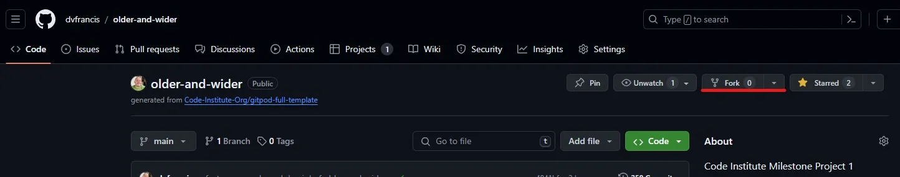

### Local Clones

To deploy the project on your own computer you can clone it:

- Navigate to the GitHub repository.
- Click the green '<> Code' button above the list of project files.
- From the 'Local' tab, select either HTTPS, SSH, or GitHub CLI as the method of cloning, and copy the associated link.
- Open the terminal or Bash prompt.
- Navigate to the directory where you want to store the cloned copy.
- At the prompt, type `git clone` and add the string copied earlier.
- Press 'Enter' to create the copy.


### Gitpod Workspaces

When using Gitpod, you can click the button below to create a workspace from this repository, which also requires that you [install the Gitpod browser extension](https://www.gitpod.io/docs/configure/user-settings/browser-extension).

[](https://gitpod.io/#https://github.com/dvfrancis/older-and-wider)

## Credits and References

All images on this site are taken from the podcast's [Instagram](https://www.instagram.com/olderandwiderpodcast/) page, the Older and Wider shop at [olderandwider.shop](https://olderandwider.shop), or the 2027 tour poster. The colours and fonts of the site also come from the tour poster. Links to live sites are also used for the social media icons, and in the footer. This is done to help promote the podcast, and as a mark of respect for all the work that has gone into it. Once this project has been assessed, my intention is to get in touch with the podcast to let Jenny and Judith know about it.

The following references were used for general advice and help in implementing specific functionality on the website:
- [Duckett, J. (2011) HTML & CSS - Design and Build Websites. Indianapolis: John Wiley & Sons, Inc.](https://htmlandcssbook.com/) - general coding advice.
- [Microsoft Edge Copilot](https://www.microsoft.com/en-us/edge/features/copilot) - coding advice, particularly around CSS rules of ingeritance.
- [How to create a copyright symbol](https://blog.hubspot.com/website/html-code-copyright) - creating the copyright symbol in the footer.
- [How to set a favicon in GitHub Pages]( https://stackoverflow.com/questions/35037482/favicon-with-github-pages) - setting a favicon on GitGub Pages.
- [W3 Schools CSS :visited Selector](https://www.w3schools.com/cssref/sel_visited.php) and 
 [CSS-Tricks :visited](https://css-tricks.com/almanac/selectors/v/visited/) - styling the navigation links after they had been visited.
- [Background on semantic HTML5 elements](https://www.freecodecamp.org/news/semantic-html5-elements/) - ordering semantic HTMl elements.
- [Redirect to custom form completion page](https://developer.mozilla.org/en-US/docs/Web/HTTP/Redirections?ref=library.linkbot.com) - creating a redirect from the website's custom completion pages (earlier design; the redesign removed these pages and the redirect).
- [How to Implement ARIA Tags for Better Accessibility](https://dev.to/sarveshh/how-to-implement-aria-tags-for-better-accessibility-a-comprehensive-guide-for-web-developers-h3k) - how and where to use ARIA tags.
- [Using Media queries](https://developer.mozilla.org/en-US/docs/Web/CSS/CSS_media_queries/Using_media_queries) - creating media queries to control ``body`` padding at different screen sizes.
- [Creating a custom 404 page for your GitHub Pages site](https://docs.github.com/en/pages/getting-started-with-github-pages/creating-a-custom-404-page-for-your-github-pages-site) - implementing a GutHub Pages custom 404 page.
- [How To Change the Color of the Bootstrap 5 Mobile Menu Icon](https://www.youtube.com/watch?v=45QSuJaHEss) - altering the colour of the hamburger menu on mobile devices (earlier design).
- [How to use srcset and sizes for responsive images](https://stackoverflow.com/questions/35099471/how-to-use-srcset-and-sizes-for-responsive-images) - making the website's images responsive.
- [The Only Markdown Cheatsheet You Need](https://github.com/im-luka/markdown-cheatsheet) - creating the README.md and TESTING.md documentation.

References used to gain a general understanding about the podcast, and for creating website content:

- PodcastingToday press release for the 2027 tour (November 2026) - the source of the figure of over 7.5 million downloads.

- [Jenny Eclair's website](https://jennyeclair.com)
- [Jenny Eclair's Wikipedia page](https://en.wikipedia.org/wiki/Jenny_Eclair)
- [Interview in The Guardian with Jenny Eclair](https://www.theguardian.com/stage/2020/jun/28/jenny-eclair-menopause-gave-me-incandescent-rage-it-was-like-a-superpower)
- [Jenny Eclair's Amazon author profile](https://www.amazon.co.uk/stores/author/B001KDFYU2/allbooks)
- [Judith Holder's website](http://www.judithholder.com/)
- [Interview in The Guardian with Judith Holder](https://www.theguardian.com/lifeandstyle/2023/aug/14/a-new-start-after-60-i-came-out-of-my-shell-when-i-retired-now-im-a-podcast-star-at-67)
- [Interview in Readers Digest with Judith Holder](https://www.readersdigest.co.uk/inspire/life/under-the-grandfluence-judith-holder)
- [Judith Holder's Amazon author profile](https://www.amazon.co.uk/stores/author/B001KJ46JG?ingress=0&visitId=2980f5c1-ed6a-45d2-ab5b-16abd95eaa16&ref_=sr_ntt_srch_lnk_1)
- [Wikipedia entry about 'Grumpy Old Women'](https://en.wikipedia.org/wiki/Grumpy_Old_Women)
- [The Older & Wider Facebook](https://www.facebook.com/profile.php?id=61555198800248)
- [Older & Wider Live! Avalon Press Release #1](https://avalonuk.com/2023/03/23/jenny-eclair-and-judith-holder-co-writers-of-internationally-successful-grumpy-old-women-live-stage-shows-bring-their-podcast-series-older-and-wider-to-the-london-stage-this-summer/)
- [Older & Wider Live! Avalon Press Release #2](https://avalonuk.com/2023/03/29/extra-london-date-at-leicester-square-theatre-announced-for-jenny-eclair-and-judith-holders-older-and-wider-live-podcast-show/)
- [Older & Wider Live! Theatre at The Tabard](https://tabard.org.uk/whats-on/olderandwider/)
- [What's On Stage - Older & Wider Live!](https://www.whatsonstage.com/shows/outer-london-theatre/older-and-wider-live_300423/)
- [UKTW - Older & Wider Live!](https://www.uktw.co.uk/archive/Tour/Talk/Older-and-Wider-live/T833145318/)
- [The Lowry - Older & Wider Live!](https://thelowry.com/whats-on/older-and-wider-live-jenny-eclair-and-judith-holder/)
- [See Tickets - Older & Wider Live!](https://www.seetickets.com/tour/older-and-wider-live)

Data for the venue list and map on the archive page:

- Town positions and counties © [OpenStreetMap contributors](https://www.openstreetmap.org/copyright), from the Nominatim service.
- Coastline from [Natural Earth](https://www.naturalearthdata.com/), 1:50m land, public domain.

Links to the podcast, on various platforms:

- [Acast](https://shows.acast.com/older-and-wider-podcast)
- [Apple Podcasts](https://podcasts.apple.com/gb/podcast/older-and-wider-podcast/id1446310659)
- [Spotify](https://open.spotify.com/show/3ScVA6cJZpMifpJJDmmodP)
- [Soundcloud](https://soundcloud.com/user-575974822)
    
## Technologies Used

- The website is built with [HTML](https://en.wikipedia.org/wiki/HTML) and [CSS](https://en.wikipedia.org/wiki/CSS). The earlier design also used [Bootstrap](https://en.wikipedia.org/wiki/Bootstrap_(front-end_framework)). The redesign removed it.
- [JavaScript](https://en.wikipedia.org/wiki/JavaScript) is used in seven small scripts. The site works without them.
    - `assets/js/consent.js` shows the cookie banner and stores the choice.
    - `assets/js/analytics.js` loads Google Analytics only after the visitor accepts.
    - `assets/js/player.js` loads the Acast player only when the visitor presses "Play here".
    - `assets/js/message-board.js` loads the Instagram posts only when the visitor asks for them.
    - `assets/js/board-date.js` shows the date of today on the message board.
    - `assets/js/live-shows.js` moves each past show to Recent shows.
    - `assets/js/archive-venues.js` shows the venue search and the letter buttons on the archive page.
- [Google Analytics](https://marketingplatform.google.com/about/analytics/) counts visits, only after the visitor accepts analytics cookies.
- [Google Chrome Developer Tools](https://developer.chrome.com/docs/devtools/) was used for website troubleshooting, and testing (including [Lighthouse](https://developer.chrome.com/docs/lighthouse/overview/) reports).
- [Google Chrome](https://www.google.co.uk/chrome/) was used for website testing.
- The [Responsive Viewer](https://responsiveviewer.org/) extension was used in all browsers (except Firefox, which does not seem to support it) to create images of the website's pages on a variety of devices.
- The [GoFullPage](https://gofullpage.com/) extension was used in all browsers (except Firefox, which does not seem to support it) to capture full-sized images of the website's pages.
- [Microsoft Edge](https://www.microsoft.com/en-gb/edge/) was used for website testing.
- [Firefox](https://www.mozilla.org/en-GB/firefox/new/) was used for website testing.
- [Opera](https://www.opera.com/) was used for website testing.
- [Safari](https://www.apple.com/uk/safari/) was used for website testing, and mobile screenshots ofan iPhone 12 Pro Max and iPad Pro (12.9-inch) (2nd generation).
- [Figma](https://www.figma.com/) was used to create the wireframes and the user flow diagram.
- [Elfsight](https://elfsight.com/) was used to create the Instagram embed code for message-board.html in the earlier design. The redesign uses Instagram's own `embed.js`, which loads only when the visitor asks.
- [Sarah Renae Clarke's Colour Catalogue V2](https://sarahrenaeclark.com/color-palettes/) was used to determine the colour scheme of the earlier design.
- [Font Joy](https://fontjoy.com/) was used to determine font pairings for the earlier design.
- [Google Fonts](https://fonts.google.com/) is the source of the Anton, Barlow Condensed and Barlow font files. The site hosts the files. All three fonts use the SIL Open Font License. The earlier design used Marcellus and Pontano Sans.
- [Brand Palettes](https://brandpalettes.com) was used to source the correct Instagram and Facebook colours.
- [Microsoft Photos](https://apps.microsoft.com/detail/9wzdncrfjbh4?hl=en-gb&gl=US) was used to edit all images.
- [RespImageLint](https://ausi.github.io/respimagelint/) was used to ensure all website images were fully responsive.
- [To WebP](https://towebp.io/) was used to compress images into webp format.
- [FontAwesome](https://fontawesome.com/) was used for social media icons.
- [GitHub](https://github.com/) was used for version control.
- [Amazon S3](https://aws.amazon.com/s3/) was used to store the website files.
- [Amazon CloudFront](https://aws.amazon.com/cloudfront/) was used to serve the website.
- [AWS CloudFormation](https://aws.amazon.com/cloudformation/) was used to create the deployment role.
- [GitHub Actions](https://github.com/features/actions) was used to deploy the website automatically.
- [Gitpod](https://gitpod.io/) was used as an online IDE.
- [Markdown](https://en.wikipedia.org/wiki/Markdown) was used to create the README.md and TESTING.md documentation.

## Acknowledgements

Thanks to my mentor, Juliia Konovalova, my cohort facilitator, Lewis Dillon, and fellow student cohorts, in particular Luke McCall, for their support and advice.

Extra special thanks to Andrew Parton, for always being there.
