[Return to Older and Wider README.md](https://github.com/dvfrancis/older-and-wider/blob/main/README.md)

# Testing

## Index

1. [Test Status After the Redesign](#test-status-after-the-redesign)
2. [Code Validation](#code-validation)
    1. [HTML](#html)
        1. [HTML Results for the New Design](#html-results-for-the-new-design)
        2. [Earlier HTML Results](#earlier-html-results)
    2. [CSS](#css)
        1. [main.css](#maincss)
        2. [Validator Limits](#validator-limits)
        3. [Earlier CSS Results](#earlier-css-results)
    3. [Sitemap and robots.txt](#sitemap-and-robotstxt)
3. [Automated Tests](#automated-tests)
    1. [Episode Update Script](#episode-update-script)
    2. [Running the Tests](#running-the-tests)
    3. [Episode Update Results](#episode-update-results)
    4. [Instagram Update Script](#instagram-update-script)
    5. [Instagram Update Results](#instagram-update-results)
4. [Manual Validation](#manual-validation)
    1. [index.html](#indexhtml)
    2. [mailing-list-completion.html (page removed)](#mailing-list-completionhtml-page-removed-1)
    3. [about.html](#abouthtml)
    4. [message-board.html](#message-boardhtml)
    5. [contact.html (page removed)](#contacthtml-page-removed-1)
    6. [contact-completion.html (page removed)](#contact-completionhtml-page-removed-1)
    7. [404.html](#404html)
    8. [privacy.html](#privacyhtml)
    9. [live-shows.html](#live-showshtml)
    10. [archive.html](#archivehtml)
    11. [Cookie Consent and Click-to-Load](#cookie-consent-and-click-to-load)
5. [User Story Validation](#user-story-validation)
    1. [First Time Visitor Goals](#first-time-visitor-goals)
    2. [Returning Visitor Goals](#returning-visitor-goals)
    3. [Frequent Visitor Goals](#frequent-visitor-goals)
6. [Browser Compatibility](#browser-compatibility)
    1. [Results for the new design](#results-for-the-new-design)
    2. [Results for the earlier design](#results-for-the-earlier-design)
    3. [Google Chrome](#google-chrome)
    4. [Microsoft Edge](#microsoft-edge)
    5. [Firefox](#firefox)
    6. [Opera](#opera)
    7. [Safari (on an iPad)](#safari-on-an-ipad)
    8. [Safari (on an iPhone)](#safari-on-an-iphone)
7. [Accessibility](#accessibility)
    1. [index.html](#indexhtml-1)
    2. [mailing-list-completion.html (page removed)](#mailing-list-completionhtml-page-removed-2)
    3. [about.html](#abouthtml-1)
    4. [message-board.html](#message-boardhtml-1)
    5. [contact.html (page removed)](#contacthtml-page-removed-2)
    6. [contact-completion.html (page removed)](#contact-completionhtml-page-removed-2)
    7. [404.html](#404html-1)
8. [Responsiveness](#responsiveness)
    1. [index.html](#indexhtml-2)
    2. [mailing-list-completion.html (page removed)](#mailing-list-completionhtml-page-removed-3)
    3. [about.html](#abouthtml-2)
    4. [message-board.html](#message-boardhtml-2)
    5. [contact.html (page removed)](#contacthtml-page-removed-3)
    6. [contact-completion.html (page removed)](#contact-completionhtml-page-removed-3)
    7. [404.html](#404html-2)
9. [Performance](#performance)
    1. [Lighthouse results for the new design](#lighthouse-results-for-the-new-design)
    2. [Lighthouse results for the earlier design](#lighthouse-results-for-the-earlier-design)
    3. [index.html](#indexhtml-3)
    4. [mailing-list-completion.html (page removed)](#mailing-list-completionhtml-page-removed-4)
    5. [about.html](#abouthtml-3)
    6. [message-board.html](#message-boardhtml-3)
    7. [contact.html (page removed)](#contacthtml-page-removed-4)
    8. [contact-completion.html (page removed)](#contact-completionhtml-page-removed-4)
    9. [404.html](#404html-3)
10. [Bugs](#bugs)
11. [Unfixed Bugs](#unfixed-bugs)

## Test Status After the Redesign

The site had a full redesign in November 2026. The redesign made these changes:

- The site now has five pages: `index.html`, `about.html`, `message-board.html`, `404.html` and `privacy.html`.
- The redesign removed `contact.html`, `contact-completion.html` and `mailing-list-completion.html`.
- One stylesheet, `assets/css/main.css`, replaced `styles.css` and Bootstrap.
- Four small scripts:
    - `assets/js/consent.js` shows the cookie banner.
    - `assets/js/analytics.js` loads Google Analytics after consent.
    - `assets/js/player.js` loads the Acast player when the visitor asks.
    - `assets/js/message-board.js` loads the Instagram posts when the visitor asks.
- No page has an automatic redirect.

The status of each test is:

| TEST | STATUS |
| --- | --- |
| HTML validation | Done on the new design, 27 November 2026 |
| CSS validation | Done on the new design, 27 November 2026 |
| Manual validation | Earlier design only. To be re-run on the new design. |
| User story validation | Earlier design only. To be re-run on the new design. |
| Browser compatibility | Done on the new design, 27 November 2026 |
| Accessibility (WAVE) | Earlier design only. To be re-run on the new design. |
| Responsiveness | Earlier design only. To be re-run on the new design. |
| Performance (Lighthouse) | Done on the new design, 27 November 2026 |
| Automated tests (episode update) | Done, 28 November 2026. All 24 tests pass. |
| Automated tests (Instagram update) | Done, 28 November 2026. All 44 tests pass. |

**Browser tests: done on the new design.** The results are in the Browser Compatibility section. The Lighthouse scores for the new design are in the Performance section. The screenshots in the sections after Code Validation show the earlier design.

This document keeps the results for the removed pages for the record. Each heading for a removed page has the label "(page removed)".

## Code Validation

### HTML

#### HTML Results for the New Design

The [W3C Nu HTML Checker](https://validator.w3.org/nu/) checked the source file of each page on 27 November 2026. The checker version was 26.11.27.

| PAGE | ERRORS | WARNINGS | RESULT |
| --- | --- | --- | --- |
| index.html | 0 | 0 | PASS |
| about.html | 0 | 0 | PASS |
| message-board.html | 0 | 0 | PASS |
| 404.html | 0 | 0 | PASS |
| privacy.html | 0 | 0 | PASS |
| live-shows.html | 0 | 0 | PASS |

On 28 November 2026 the checker checked each page again, after the change to the navigation. The checker found no errors and no warnings on `live-shows.html`, `index.html`, `about.html`, `message-board.html`, `privacy.html` and `404.html`.

To repeat the test, run this command in the repository root for each page:

```bash
curl -s -H 'Content-Type: text/html; charset=utf-8' --data-binary @index.html 'https://validator.w3.org/nu/?out=gnu'
```

An empty output means that the checker found no errors and no warnings. Screenshots of the new results are to be added.

#### Earlier HTML Results

These results are for the earlier design. The [W3C Markup Validation Service](https://validator.w3.org) made them.

##### index.html (earlier design)


##### mailing-list-completion.html (page removed)

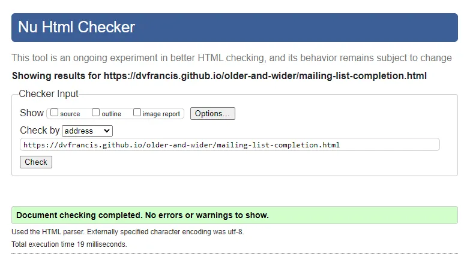

##### about.html (earlier design)


##### message-board.html (earlier design)

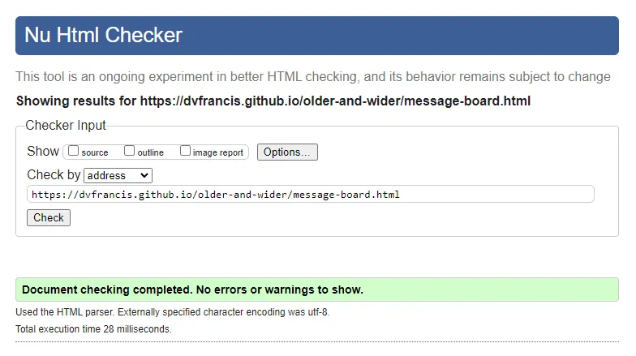

##### contact.html (page removed)


##### contact-completion.html (page removed)

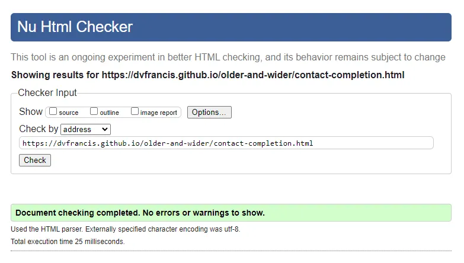

##### 404.html (earlier design)


### CSS

#### main.css

The [W3C CSS Validation Service](https://jigsaw.w3.org/css-validator) checked `assets/css/main.css` on 27 November 2026. The profile was "CSS level 3 + SVG", with all warnings shown.

| FILE | ERRORS | WARNINGS |
| --- | --- | --- |
| main.css | 3 | 63 |

The 3 errors are limits of the validator. They are not errors in the CSS. The section [Validator Limits](#validator-limits) gives the reason for each error.

The 63 warnings are:

- 60 warnings that the validator does not check CSS custom properties (variables). This is a limit of the validator.
- 3 warnings that `-webkit-mask` (two times) and `-webkit-mask-composite` are vendor extensions. The stylesheet uses them as a fallback for older WebKit browsers. The standard `mask` properties follow them.

To repeat the test, run this command in the repository root:

```bash
curl -s -F "file=@assets/css/main.css;type=text/css" -F output=text -F profile=css3svg -F warning=1 'https://jigsaw.w3.org/css-validator/validator'
```

Screenshots of the new results are to be added.

#### Validator Limits

The validator does not know three CSS features that `main.css` uses. Current versions of Chrome, Edge, Firefox and Safari support all three features.

| LINE | SELECTOR | VALIDATOR MESSAGE | REASON |
| --- | --- | --- | --- |
| 147 | `.cover-inner` | Property "container-type" does not exist | `container-type` comes from the CSS container queries specification. The validator does not know this property. |
| 153 | `.masthead` | Value Error: font-size. Parse Error | The value is `calc(100cqi / 6.45)`. `cqi` is a container query unit. The validator does not know this unit, so it cannot read the `calc()`. |
| 986 | `.cover-photo` | Too many values or values are not recognized | The `mask` property has two `linear-gradient()` layers. The CSS Masking specification permits a comma-separated list of mask layers. The validator does not accept the list. |

#### Earlier CSS Results

These results are for the earlier design. They check `styles.css` and Bootstrap. The redesign deleted `styles.css` and removed Bootstrap. There were no warnings for the local CSS file, but warnings were generated for Bootstrap's CSS file, over which I had no control:


##### index.html (earlier CSS)


##### mailing-list-completion.html (page removed, earlier CSS)

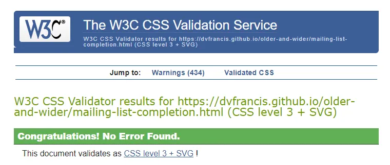

##### about.html (earlier CSS)

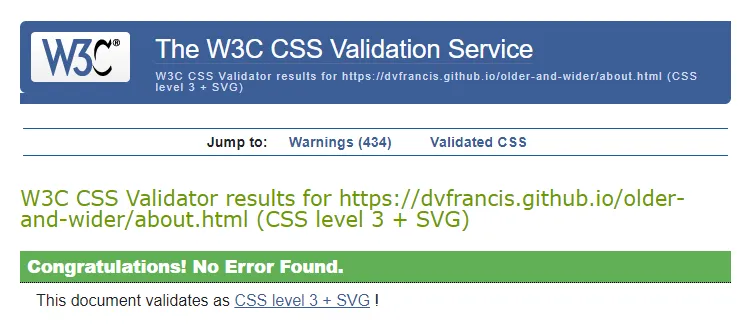

##### message-board.html (earlier CSS)


##### contact.html (page removed, earlier CSS)


##### contact-completion.html (page removed, earlier CSS)

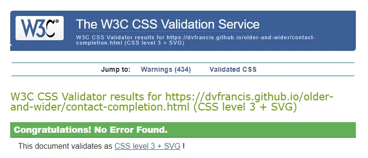

##### 404.html (earlier CSS)

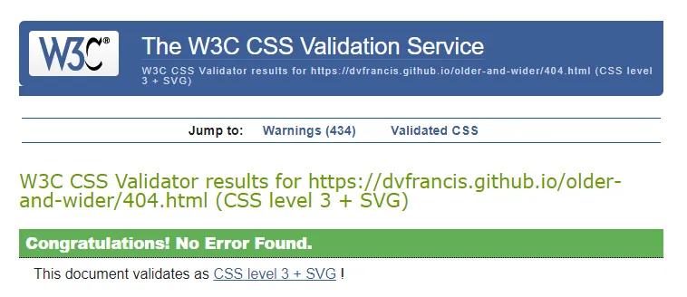

### Sitemap and robots.txt

These checks apply to `sitemap.xml` and `robots.txt` in the repository root.

| CHECK | RESULT |
| --- | --- |
| `sitemap.xml` is well-formed XML | Pass |
| `sitemap.xml` lists the home page, `about.html`, `message-board.html` and `privacy.html` | Pass |
| `sitemap.xml` does not list `404.html` | Pass |
| `robots.txt` contains the `Sitemap` line with the full address | Pass |
| `./build.sh` copies both files into `deploy/` | Pass |
| The live `sitemap.xml` loads as XML | To be tested after the deploy |
| The live `robots.txt` returns 200 as `text/plain` | To be tested after the deploy |
| Google Search Console reads the sitemap with no errors | To be tested after the deploy |

To repeat the local checks, run these commands in the repository root:

```bash
python3 -c "import xml.dom.minidom; xml.dom.minidom.parse('sitemap.xml')"
./build.sh
ls deploy/sitemap.xml deploy/robots.txt
```

The first command shows no output if the XML is well-formed.

## Automated Tests

### Episode Update Script

The script `scripts/update_episodes.py` updates the episode content of the home page from the podcast RSS feed. The README describes the script in the section "Automatic Episode Update".

The file `scripts/test_update_episodes.py` contains the tests for the script. The tests use the Python `unittest` module. They do not use the network. They do not change `index.html`.

The tests use these fixture files in `scripts/fixtures/`:

| FILE | CONTENT |
| --- | --- |
| `index.html` | A copy of the home page at episode 374. The tests change only a temporary copy of this file. |
| `feed-current.xml` | The 20 newest items of the live feed on 28 November 2026. The long descriptions are removed. |
| `feed-new-episode.xml` | The current feed with a new episode 375 on 4 December 2026. The title contains `&` and `<>`. The duration is longer than one hour. |
| `feed-no-numbers.xml` | The current feed with no episode numbers in the titles. |
| `feed-broken.xml` | The first half of the current feed. It is not valid XML. |
| `feed-short.xml` | The 15 newest items only. The script needs 16. |

The tests examine these conditions:

| TEST | EXPECTED RESULT |
| --- | --- |
| The current feed | The page does not change. `--check` exits with code 0. |
| A new episode 375 | The masthead shows "Issue 375 · 4 December 2026". |
| A new episode 375 | The cover and "This week" show episode 375, its title, its date and the duration 1:02:03. |
| A new episode 375 | The ticket serial shows "Ticket 375". |
| A new episode 375 | The ticket shows 360 to 374 in the same cells. 371 to 374 have a dab. Each number links to its own episode. |
| A new episode 375 | "Last called" shows 374, 373, 372 and 371, with their dates and durations. |
| A new episode 375 | The text outside the markers does not change. A second run makes no change. |
| A new episode 375 with `--check` | The script shows a diff and exits with code 1. The page does not change. |
| A broken feed | The script exits with code 2. The page does not change. |
| A feed with no episode numbers | The script exits with code 2. The page does not change. |
| A feed with fewer than 16 episodes | The script exits with code 2. The page does not change. |
| A missing feed file | The script exits with code 2. The page does not change. |
| A page with no markers | The script exits with code 2. The page does not change. |
| An older item with no number | The script skips the item and uses the next episode. |
| A repost of episode 200 in the middle of the feed | The script skips the repost. The episodes stay in number order. |
| A repost of episode 373 as the newest item | Episode 374 stays the latest episode. |
| A new episode 375 | The `lastmod` date of the home page in `sitemap.xml` changes to the date of episode 375. |
| A bad feed | `sitemap.xml` does not change. |
| The live `index.html` | It contains each pair of episode markers. |
| Title prefixes, durations and dates | "Ep 374.", "Ep. 366" and "Episode 12:" give the correct number. "2027: the tour is on sale" gives no number. Durations show as m:ss or h:mm:ss. Dates show in UK format. |

### Running the Tests

To run the tests, do these steps:

1. Open a terminal in the repository root.
2. Run the command `python3 -m unittest discover -s scripts -v`.
3. Make sure that the last line of the output is `OK`.

To compare the page with the live feed, run the command `python3 scripts/update_episodes.py --check`. The command exits with code 0 if the page is up to date.

The workflow `.github/workflows/update-episodes.yml` runs the tests before each update. If a test fails, the workflow stops. The page does not change.

### Episode Update Results

The results on 28 November 2026 were these:

| TEST | RESULT |
| --- | --- |
| `python3 -m unittest discover -s scripts -v` | Pass. 28 tests ran with no failures. |
| `python3 scripts/update_episodes.py --check` against the live feed | Pass. The page is up to date at episode 374. |
| W3C Markup Validator on `index.html` with episode 375 from `feed-new-episode.xml` | Pass. No errors and no warnings. |
| W3C Markup Validator on `index.html` with the live feed | Pass. No errors and no warnings. |
| `./build.sh` | Pass. |

### Instagram Update Script

The script `scripts/update_instagram.py` updates the posts on the message board page. The README describes the script in the section "Instagram Posts".

The file `scripts/test_update_instagram.py` contains the tests for the script. The tests use the Python `unittest` module. They do not use the network. They do not need a token. They do not change `message-board.html`, `sitemap.xml` or `scripts/instagram-posts.txt`. The tests that make WebP files need the `cwebp` command. The workflow installs `cwebp` before the tests.

The tests use these fixture files in `scripts/fixtures/instagram/`:

| FILE | CONTENT |
| --- | --- |
| `message-board.html` | A copy of the message board page with the Instagram markers. The tests change only a temporary copy of this file. |
| `media.json` | A saved API response with 12 posts. It has photos, videos, photo sets, a video with no thumbnail, a post with no caption and a caption with `<script>` and `&`. |
| `media-next.json` | The same response with one newer post at the top. |
| `media-error.json` | An API error for an expired token. |
| `media-unusable.json` | One video with no thumbnail. The script cannot show it. |
| `media-bad-host.json` | One photo on a host that is not an Instagram host. |
| `images/photo-1.jpg` to `images/photo-4.jpg` | Small JPEG photos. The script reads them in place of the Instagram photos. |

The tests examine these conditions:

| TEST | EXPECTED RESULT |
| --- | --- |
| A normal update in API mode | The page shows 10 posts, newest first. The video with no thumbnail and the eleventh post are not on the page. |
| A normal update in API mode | Each `img` has a `srcset`, `sizes`, `width`, `height`, `loading="lazy"` and alt text. The WebP files in the folder agree with the page. |
| A normal update in API mode | The text outside the markers does not change. The embed markup is not between the markers. |
| A normal update in API mode | The card text is the first line of the caption, without hashtags. A long caption ends with an ellipsis. |
| A normal update in API mode | `alt_text` is the alt text. Without a caption, the alt text gives the date. |
| A normal update in API mode | The `lastmod` date of the message board in `sitemap.xml` changes to the date of the run. |
| A second run with the same data | The page, the sitemap and the image files do not change. `--check` exits with code 0. |
| A caption with `<script>`, `&` and quotes | The text is escaped in the card and in the alt text. |
| A video and a photo set | A video uses `thumbnail_url`. A photo set uses its first item. A video item in a set uses its thumbnail. |
| A newer post | The script deletes the files of the post that leaves the page. It keeps other files in the folder. |
| `--check` in API mode | The script shows a diff and the new image files. It exits with code 1. Nothing changes. |
| An API error | The script exits with code 2. Nothing changes. |
| No usable posts, a photo on another host, or a missing fixture | The script exits with code 2. Nothing changes. |
| A page with no end marker | The script exits with code 2. Nothing changes. |
| No `cwebp` command in API mode | The script exits with code 2 and names `cwebp`. Nothing changes. |
| A network error and an HTTP error that contain the token | The token is not in the output. The output shows `access_token=[hidden]`. |
| A good run in API mode | The token is not in the output or the page. The request goes to `graph.instagram.com/v27.0`. |
| A token refresh | The new token goes into a file with mode 600. The output shows the new token only in the `::add-mask::` command. |
| A refresh error or a bad refresh response | The script exits with code 2. The old token is not in the output. The script writes no file. |
| The seeded post list | It gives the page of today with no diff, on the fixture page and on the live page. |
| A normal update in list mode | The page shows the posts in the embed markup, with escaped text, the correct type and no image files. |
| A second run in list mode | The page and the sitemap do not change. |
| A list with 12 posts | The page shows the 10 newest posts. |
| Notes and blank lines in the list | The page does not show them. |
| A bad line in the list | The script exits with code 2 and names the line number. Nothing changes. The tests use a bad date, an impossible date, three bad addresses, empty text, too few parts and a bad fourth part. |
| A missing post list | The script exits with code 2. Nothing changes. |
| Both secrets exist | The script uses the API and ignores the list. |
| The live `message-board.html` | It contains one pair of Instagram markers. |

### Instagram Update Results

The results on 28 November 2026 were these:

| TEST | RESULT |
| --- | --- |
| `python3 -m unittest discover -s scripts -v` | Pass. 72 tests ran with no failures. |
| `python3 scripts/update_instagram.py --check` in list mode | Pass. The page is up to date. |
| `python3 scripts/update_instagram.py --check --fixture scripts/fixtures/instagram/media.json` on a copy of the page | Pass. The diff shows 10 cards and 20 new image files. |
| W3C Markup Validator on `message-board.html` | Pass. No errors and no warnings. |
| W3C Markup Validator on `message-board.html` with the 10 posts from `media.json` | Pass. No errors and no warnings. |
| `./build.sh` | Pass. |

## Manual Validation

These results are for the earlier design. They include the "Contact" link, the image carousels and the forms. The redesign removed these items. To be re-run on the new design.

Here are the results of a manual test of all links, and any form fields, for each page:

### index.html

| ITEM | PROCESS | EXPECTED RESULT | ACTUAL RESULT | STATUS |
| --- | --- | --- | --- | --- |
| Site title - "The Older & Wider Podcast" | Click to return to index.html | The user is redirected to index.html (even if already there) | The user is redirected to index.html (even if already there) | PASS |
| Navigation bar link - "Home" | Click to open index.html | The user is redirected to index.html (even if already there) | The user is redirected to index.html (even if already there) | PASS |
| Navigation bar link - "About" | Click to open about.html | The user is redirected to about.html (even if already there) | The user is redirected to about.html (even if already there) | PASS |
| Navigation bar link - "Message Board" | Click to open message-board.html | The user is redirected to message-board.html (even if already there) | The user is redirected to message-board.html (even if already there) | PASS |
| Navigation bar link - "Contact"" | Click to open contact.html | The user is redirected to contact.html (even if already there) | The user is redirected to contact.html (even if already there) | PASS |
| Image carousel | Use arrow and indicator controls to move between all image slides | Slides transition succesfully | Slides transition succesfully | PASS |
| Link - "Acast" | Click to open external website in new tab | The link opens in a new tab | The link opens in a new tab | PASS |
| Link - "Apple Podcasts" | Click to open external website in new tab | The link opens in a new tab | The link opens in a new tab | PASS |
| Link - "Spotify" | Click to open external website in new tab | The link opens in a new tab | The link opens in a new tab | PASS |
| Button - "About the Podcast" | Click to move to about.html | The user is redirected to the about page | The user is redirected to the about page | PASS |
| Podcast player | Click play to play the podcast, and then click pause to pause playback | Playback begins or ends | Playback begins or ends | PASS |
| Button - "Buy Tickets" | Click to open external website in new tab | The link opens in a new tab | The link opens in a new tab | PASS |
| Button - "See the Merch" | Click to open external website in new tab | The link opens in a new tab | The link opens in a new tab | PASS |
| "Mailing List" - using a valid email | Enter a valid email address and click 'Send' | The email address is accepted and the user redirected to mailing-list-completion.html  | The email is accepted and the user is redirected to mailing-list-completion.html | PASS |
| "Mailing List" - using an invalid email | Enter an invalid email address and click 'Send' | The email address is rejected  | The email is rejected | PASS |
| Social media icon - Instagram | Click to open the Older & Wider Instagram page in a new tab  | The link opens in a new tab  | The link opens in a new tab | PASS |
| Social media icon - Facebook | Click to open the Older & Wider Facebook page in a new tab  | The link opens in a new tab  | The link opens in a new tab | PASS |
| Footer link - "Dominic Francis" | Click to open dominicfrancis.co.uk in a new tab | The link opens in a new tab  | The link opens in a new tab | PASS |
| Footer link - "Older & Wider" | Click to open the Acast Older & Wider website in a new tab | The link opens in a new tab  | The link opens in a new tab | PASS |
| Footer link - "Acast" | Click to open the Acast website in a new tab | The link opens in a new tab  | The link opens in a new tab | PASS |

### mailing-list-completion.html (page removed)

The redesign removed this page. These results are kept for the record.

| ITEM | PROCESS | EXPECTED RESULT | ACTUAL RESULT | STATUS |
| --- | --- | --- | --- | --- |
| Site title - "The Older & Wider Podcast" | Click to return to index.html | The user is redirected to index.html (even if already there) | The user is redirected to index.html (even if already there) | PASS |
| Navigation bar link - "Home" | Click to open index.html | The user is redirected to index.html (even if already there) | The user is redirected to index.html (even if already there) | PASS |
| Navigation bar link - "About" | Click to open about.html | The user is redirected to about.html (even if already there) | The user is redirected to about.html (even if already there) | PASS |
| Navigation bar link - "Message Board" | Click to open message-board.html | The user is redirected to message-board.html (even if already there) | The user is redirected to message-board.html (even if already there) | PASS |
| Navigation bar link - "Contact"" | Click to open contact.html | The user is redirected to contact.html (even if already there) | The user is redirected to contact.html (even if already there) | PASS |
| Auto redirect (after 30 seconds) | The page is automatically redirected to index.html after 30 seconds have elapsed | The index.html page loads after 30 seconds | The index.html page loads after 30 seconds | PASS |
| Button - "Return to the home page" | Click to move to index.html | The user is redirected to the home page | The user is redirected to the home page | PASS |
| Button - "Learn about the podcast" | Click to move to about.html | The user is redirected to the about page | The user is redirected to the about page | PASS |
| Button - "View the 'Message Board'" | Click to move to message-board.html | The user is redirected to the message board page | The user is redirected to the message board page | PASS |
| Button - "Why not send us a message?" | Click to move to contact.html | The user is redirected to the contact page | The user is redirected to the contact page | PASS |
| Social media icon - Instagram | Click to open the Older & Wider Instagram page in a new tab  | The link opens in a new tab  | The link opens in a new tab | PASS |
| Social media icon - Facebook | Click to open the Older & Wider Facebook page in a new tab  | The link opens in a new tab  | The link opens in a new tab | PASS |
| Footer link - "Dominic Francis" | Click to open dominicfrancis.co.uk in a new tab | The link opens in a new tab  | The link opens in a new tab | PASS |
| Footer link - "Older & Wider" | Click to open the Acast Older & Wider website in a new tab | The link opens in a new tab  | The link opens in a new tab | PASS |
| Footer link - "Acast" | Click to open the Acast website in a new tab | The link opens in a new tab  | The link opens in a new tab | PASS |

### about.html

| ITEM | PROCESS | EXPECTED RESULT | ACTUAL RESULT | STATUS |
| --- | --- | --- | --- | --- |
| Site title - "The Older & Wider Podcast" | Click to return to index.html | The user is redirected to index.html (even if already there) | The user is redirected to index.html (even if already there) | PASS |
| Navigation bar link - "Home" | Click to open index.html | The user is redirected to index.html (even if already there) | The user is redirected to index.html (even if already there) | PASS |
| Navigation bar link - "About" | Click to open about.html | The user is redirected to about.html (even if already there) | The user is redirected to about.html (even if already there) | PASS |
| Navigation bar link - "Message Board" | Click to open message-board.html | The user is redirected to message-board.html (even if already there) | The user is redirected to message-board.html (even if already there) | PASS |
| Navigation bar link - "Contact"" | Click to open contact.html | The user is redirected to contact.html (even if already there) | The user is redirected to contact.html (even if already there) | PASS |
| Image carousel for "What is Older & Wider?" | Use arrow and indicator controls to move between all image slides | Slides transition succesfully | Slides transition succesfully | PASS |
| Image carousel for "Who is Judith Holder" | Use arrow and indicator controls to move between all image slides | Slides transition succesfully | Slides transition succesfully | PASS |
| Image carousel for "Who is Jenny Eclair?" | Use arrow and indicator controls to move between all image slides | Slides transition succesfully | Slides transition succesfully | PASS |
| Social media icon - Instagram | Click to open the Older & Wider Instagram page in a new tab  | The link opens in a new tab  | The link opens in a new tab | PASS |
| Social media icon - Facebook | Click to open the Older & Wider Facebook page in a new tab  | The link opens in a new tab  | The link opens in a new tab | PASS |
| Footer link - "Dominic Francis" | Click to open dominicfrancis.co.uk in a new tab | The link opens in a new tab  | The link opens in a new tab | PASS |
| Footer link - "Older & Wider" | Click to open the Acast Older & Wider website in a new tab | The link opens in a new tab  | The link opens in a new tab | PASS |
| Footer link - "Acast" | Click to open the Acast website in a new tab | The link opens in a new tab  | The link opens in a new tab | PASS |

### message-board.html

| ITEM | PROCESS | EXPECTED RESULT | ACTUAL RESULT | STATUS |
| --- | --- | --- | --- | --- |
| Site title - "The Older & Wider Podcast" | Click to return to index.html | The user is redirected to index.html (even if already there) | The user is redirected to index.html (even if already there) | PASS |
| Navigation bar link - "Home" | Click to open index.html | The user is redirected to index.html (even if already there) | The user is redirected to index.html (even if already there) | PASS |
| Navigation bar link - "About" | Click to open about.html | The user is redirected to about.html (even if already there) | The user is redirected to about.html (even if already there) | PASS |
| Navigation bar link - "Message Board" | Click to open message-board.html | The user is redirected to message-board.html (even if already there) | The user is redirected to message-board.html (even if already there) | PASS |
| Navigation bar link - "Contact"" | Click to open contact.html | The user is redirected to contact.html (even if already there) | The user is redirected to contact.html (even if already there) | PASS |
| Instagram embed - "Older and Wider Podcast" header | Click to open the Older & Wider Instagram page in a new tab | The link opens in a new tab  | The link opens in a new tab | PASS |
| Instagram embed button - "Follow" | Click to open the Older & Wider Instagram page in a new tab | The link opens in a new tab  | The link opens in a new tab | PASS |
| Instagram embed - load more posts | Click navigation arrows on either side of the instagram embed to load more posts | More posts slide into view  | More posts slide into view | PASS |
| Instagram embed - view post | Click a post to open it in a pop-up window | The post opens in a pop-up window  | The post opens in a pop-up window | PASS |
| Instagram embed - scroll posts | Use a mouse wheel (on desktop) or a finger (on mobile) to scroll down through other posts, from within a post's pop-up window | Further posts are shown  | Further posts are shown | PASS |
| Instagram embed - close post | Use a mouse wheel (on desktop) or a finger (on mobile) to click the cross in the top-right of a post's pop-up window | The post's pop-up window closes  | The post's pop-up window closes | PASS |
| Social media icon - Instagram | Click to open the Older & Wider Instagram page in a new tab  | The link opens in a new tab  | The link opens in a new tab | PASS |
| Social media icon - Facebook | Click to open the Older & Wider Facebook page in a new tab  | The link opens in a new tab  | The link opens in a new tab | PASS |
| Footer link - "Dominic Francis" | Click to open dominicfrancis.co.uk in a new tab | The link opens in a new tab  | The link opens in a new tab | PASS |
| Footer link - "Older & Wider" | Click to open the Acast Older & Wider website in a new tab | The link opens in a new tab  | The link opens in a new tab | PASS |
| Footer link - "Acast" | Click to open the Acast website in a new tab | The link opens in a new tab  | The link opens in a new tab | PASS |

### contact.html (page removed)

The redesign removed this page. These results are kept for the record.

| ITEM | PROCESS | EXPECTED RESULT | ACTUAL RESULT | STATUS |
| --- | --- | --- | --- | --- |
| Site title - "The Older & Wider Podcast" | Click to return to index.html | The user is redirected to index.html (even if already there) | The user is redirected to index.html (even if already there) | PASS |
| Navigation bar link - "Home" | Click to open index.html | The user is redirected to index.html (even if already there) | The user is redirected to index.html (even if already there) | PASS |
| Navigation bar link - "About" | Click to open about.html | The user is redirected to about.html (even if already there) | The user is redirected to about.html (even if already there) | PASS |
| Navigation bar link - "Message Board" | Click to open message-board.html | The user is redirected to message-board.html (even if already there) | The user is redirected to message-board.html (even if already there) | PASS |
| Navigation bar link - "Contact"" | Click to open contact.html | The user is redirected to contact.html (even if already there) | The user is redirected to contact.html (even if already there) | PASS |
| Contact form - "First Name" | Where all other fields are empty, enter first name and click send | The user is prompted to enter their last name  | The user is prompted to enter their last name | PASS |
| Contact form - "Last Name" | Where all other fields are empty, except the first name, enter last name and click send | The user is prompted to enter their age  | The user is prompted to enter their age | PASS |
| Contact form - "Age" | Where all other fields are empty, except the first and last names, enter age and click send | The user is prompted to enter their email address  | The user is prompted to enter their email address | PASS |
| Contact form - "Email" - using an invalid email address | Where all other fields are empty, except the first name, last name, and age, enter an invalid email address and click 'Send' | The email address is rejected  | The email is rejected | PASS |
| Contact form - "Email" - using a valid email address | Where all other fields are empty, except the first name, last name, and age, enter a valid email address and click 'Send' | The user is prompted to enter a message  | The user is prompted to enter a message | PASS |
| Contact form - "Message" | Where all fields are completed correctly, enter a message and click 'Send' | The form is accepted and the user redirected to contact-completion.html  | The form is accepted and the user redirected to contact-completion.html | PASS |
| Contact form button - "Send" | Where all fields are completed correctly, click 'Send' | The form is accepted and the user redirected to contact-completion.html  | The form is accepted and the user redirected to contact-completion.html | PASS |
| Contact form button - "Reset" | Enter any information on the form, and click 'Reset' | The information on the form is cleared, ready for fresh data entry  | The information on the form is cleared, ready for fresh data entry | PASS |
| Social media icon - Instagram | Click to open the Older & Wider Instagram page in a new tab  | The link opens in a new tab  | The link opens in a new tab | PASS |
| Social media icon - Facebook | Click to open the Older & Wider Facebook page in a new tab  | The link opens in a new tab  | The link opens in a new tab | PASS |
| Footer link - "Dominic Francis" | Click to open dominicfrancis.co.uk in a new tab | The link opens in a new tab  | The link opens in a new tab | PASS |
| Footer link - "Older & Wider" | Click to open the Acast Older & Wider website in a new tab | The link opens in a new tab  | The link opens in a new tab | PASS |
| Footer link - "Acast" | Click to open the Acast website in a new tab | The link opens in a new tab  | The link opens in a new tab | PASS |

### contact-completion.html (page removed)

The redesign removed this page. These results are kept for the record.

| ITEM | PROCESS | EXPECTED RESULT | ACTUAL RESULT | STATUS |
| --- | --- | --- | --- | --- |
| Site title - "The Older & Wider Podcast" | Click to return to index.html | The user is redirected to index.html (even if already there) | The user is redirected to index.html (even if already there) | PASS |
| Navigation bar link - "Home" | Click to open index.html | The user is redirected to index.html (even if already there) | The user is redirected to index.html (even if already there) | PASS |
| Navigation bar link - "About" | Click to open about.html | The user is redirected to about.html (even if already there) | The user is redirected to about.html (even if already there) | PASS |
| Navigation bar link - "Message Board" | Click to open message-board.html | The user is redirected to message-board.html (even if already there) | The user is redirected to message-board.html (even if already there) | PASS |
| Navigation bar link - "Contact"" | Click to open contact.html | The user is redirected to contact.html (even if already there) | The user is redirected to contact.html (even if already there) | PASS |
| Auto redirect (after 30 seconds) | The page is automatically redirected to index.html after 30 seconds have elapsed | The index.html page loads after 30 seconds | The index.html page loads after 30 seconds | PASS |
| Button - "Return to the home page" | Click to move to index.html | The user is redirected to the home page | The user is redirected to the home page | PASS |
| Button - "Learn about the podcast" | Click to move to about.html | The user is redirected to the about page | The user is redirected to the about page | PASS |
| Button - "View the 'Message Board'" | Click to move to message-board.html | The user is redirected to the message board page | The user is redirected to the message board page | PASS |
| Social media icon - Instagram | Click to open the Older & Wider Instagram page in a new tab  | The link opens in a new tab  | The link opens in a new tab | PASS |
| Social media icon - Facebook | Click to open the Older & Wider Facebook page in a new tab  | The link opens in a new tab  | The link opens in a new tab | PASS |
| Footer link - "Dominic Francis" | Click to open dominicfrancis.co.uk in a new tab | The link opens in a new tab  | The link opens in a new tab | PASS |
| Footer link - "Older & Wider" | Click to open the Acast Older & Wider website in a new tab | The link opens in a new tab  | The link opens in a new tab | PASS |
| Footer link - "Acast" | Click to open the Acast website in a new tab | The link opens in a new tab  | The link opens in a new tab | PASS |

### 404.html

| ITEM | PROCESS | EXPECTED RESULT | ACTUAL RESULT | STATUS |
| --- | --- | --- | --- | --- |
| Site title - "The Older & Wider Podcast" | Click to return to index.html | The user is redirected to index.html (even if already there) | The user is redirected to index.html (even if already there) | PASS |
| Navigation bar link - "Home" | Click to open index.html | The user is redirected to index.html (even if already there) | The user is redirected to index.html (even if already there) | PASS |
| Navigation bar link - "About" | Click to open about.html | The user is redirected to about.html (even if already there) | The user is redirected to about.html (even if already there) | PASS |
| Navigation bar link - "Message Board" | Click to open message-board.html | The user is redirected to message-board.html (even if already there) | The user is redirected to message-board.html (even if already there) | PASS |
| Navigation bar link - "Contact"" | Click to open contact.html | The user is redirected to contact.html (even if already there) | The user is redirected to contact.html (even if already there) | PASS |
| Auto redirect (after 30 seconds) | The page is automatically redirected to index.html after 30 seconds have elapsed | The index.html page loads after 30 seconds | The index.html page loads after 30 seconds | PASS |
| Button - "Return to the home page" | Click to move to index.html | The user is redirected to the home page | The user is redirected to the home page | PASS |
| Button - "Learn about the podcast" | Click to move to about.html | The user is redirected to the about page | The user is redirected to the about page | PASS |
| Button - "View the 'Message Board'" | Click to move to message-board.html | The user is redirected to the message board page | The user is redirected to the message board page | PASS |
| Button - "Why not send us a message?" | Click to move to contact.html | The user is redirected to the contact page | The user is redirected to the contact page | PASS |
| Social media icon - Instagram | Click to open the Older & Wider Instagram page in a new tab  | The link opens in a new tab  | The link opens in a new tab | PASS |
| Social media icon - Facebook | Click to open the Older & Wider Facebook page in a new tab  | The link opens in a new tab  | The link opens in a new tab | PASS |
| Footer link - "Dominic Francis" | Click to open dominicfrancis.co.uk in a new tab | The link opens in a new tab  | The link opens in a new tab | PASS |
| Footer link - "Older & Wider" | Click to open the Acast Older & Wider website in a new tab | The link opens in a new tab  | The link opens in a new tab | PASS |
| Footer link - "Acast" | Click to open the Acast website in a new tab | The link opens in a new tab  | The link opens in a new tab | PASS |

### privacy.html

The tests used a local server and headless Google Chrome on 27 November 2026. The viewport widths were 390px and 1440px.

| TEST | EXPECTED RESULT | RESULT |
| --- | --- | --- |
| Open the page | The page shows the title, the date "Last updated 27 November 2026" and the table of third parties. | PASS |
| Check the navigation | The navigation shows Home, About, Live Shows, Archive and Message Board. No link has `aria-current`. | PASS |
| Check the table at 390px | Each service shows as one block, with a label above each value. | PASS |
| Check the table at 1440px | The table shows four columns. | PASS |
| Press "Cookie settings" in the page | The cookie banner opens. | PASS |
| Press the link to the website of Dominic Francis | The link opens https://www.dominicfrancis.co.uk/. | PASS |
| Check for horizontal scroll at 390px | The page does not scroll sideways. | PASS |

### live-shows.html

The tests used a local server and headless Google Chrome on 28 November 2026. The date of today in the UK was 28 November 2026. The viewport widths were 375px, 768px and 1440px.

| TEST | EXPECTED RESULT | RESULT |
| --- | --- | --- |
| Open the page | The page shows the title, the poster and the eight 2027 shows in Forthcoming shows, earliest first. Recent shows shows the message "No shows from this tour have happened yet". | PASS |
| Check each show | Each show gives the date with the day of the week and the year, the town or city, the venue, the tour name and a ticket link. | PASS |
| Check the ticket links | Each link text names the town and the date, for example "Tickets for Leeds, 25 April". Each address gives the status 200. The Lowry blocks automated requests, so a person must open that link in a browser. | PASS |
| Check the navigation | The navigation shows Home, About, Live Shows, Archive and Message Board. "Live Shows" has `aria-current="page"`. | PASS |
| Check the navigation at 375px | The five links fit on one row. Each link is above the masthead, so a click reaches it. | PASS |
| Check the navigation at 1440px | The five links fit on one row. | PASS |
| Check for horizontal scroll at 375px | The page does not scroll sideways. | PASS |
| Check the venues section | The section "The venues" is below Recent shows. It lists six venues in a `ul` element. Each venue gives the name, the town or city, the postal address, a website link and its show dates in `time` elements. | PASS |
| Check the Theatre at the Tabard | The venue has the label "Past shows". It lists the four shows of 2024 and 2025 from `archive.html`. It has a website link and an access link. | PASS |
| Check the venue links of the shows | Each `#venue-` link in a show agrees with an `id` on the page. A click on the link scrolls to the venue and outlines it. | PASS |
| Check a venue link after a move | The Leeds show had a past date, and the script moved it to Recent shows. Its venue link stays. A click opens `#venue-city-varieties`. | PASS |
| Check the venue website and access links | Each link gives the status 200. The Lowry (403) and the Theatre at the Tabard (429) block automated requests. A person opened those links in a browser on 28 November 2026. Each link opens the correct page. | PASS |
| Check the venues at 375px, 768px and 1440px | The venues show in one column, two columns and three columns. The page does not scroll sideways. | PASS |

These are the five manual tests of the script `assets/js/live-shows.js`. For each test, a copy of `live-shows.html` had changed dates. The script read the copy in the browser.

| TEST | EXPECTED RESULT | RESULT |
| --- | --- | --- |
| Give a show a date in the past. The Leeds show had 27 November 2026, and the Birmingham show had 10 January 2026. | The two shows move to Recent shows, with the latest date first. Their ticket links are removed. The Recent shows message is hidden. The other six shows stay in Forthcoming shows. | PASS |
| Give a show the date of today. The Leeds show had 28 November 2026. | The Leeds show stays in Forthcoming shows, with its ticket link. | PASS |
| Give every forthcoming show a date in the past. Each show had its 2027 date in 2026. | All eight shows move to Recent shows, with the latest date first and no ticket links. The Forthcoming shows list is hidden, and the message "There are no forthcoming shows at the moment" shows. | PASS |
| Turn off JavaScript, and open the copy with all dates in the past | The page shows all eight shows in Forthcoming shows, with their ticket links. No show is lost. | PASS |
| Read the browser console on each test page | The console shows no errors and no warnings. No request fails. | PASS |

### archive.html

| Test | Action | Expected result | Result |
|---|---|---|---|
| W3C Markup Validator | Send `archive.html` to the Nu validator. | No errors and no warnings. | Pass. No messages, 28 November 2026. |
| W3C CSS Validator | Send `assets/css/main.css` to the CSS validator. | No new errors from the archive block. | Pass. The three errors are older. They are on lines 185, 191 and 1030, outside the archive block. |
| Phone width | Open the page at 375 pixels wide. Open each `details` element. | No horizontal scroll. Each row of a table shows as a block. | Pass. The scroll width is 375 pixels. |
| Desktop width | Open the page at 1440 pixels wide. | The tables show as tables. The tours show in two columns. | Pass. |
| Details elements | Click the summary of each tour. Then press Enter on a summary with the keyboard. | The tour opens and closes. The plus sign changes to a minus sign. | Pass. A click opens a tour. Enter on the focused summary closes it. |
| No JavaScript | Disable JavaScript. Reload the page. | All content shows. The `details` elements still open and close. | Pass. The page has no script of its own. The HTML has 14 `details` elements, 985 table rows and 1030 `time` elements. |
| Contrast | Examine each pair of colours. | Each pair meets WCAG 2.1 level AA. Red text on pink is 1.75rem or larger. | Pass, by the contrast pairs in `DESIGN.md`. |
| Jump links | Click each link below the introduction. | The page moves to the correct section. | Pass. All 14 links in the page go to an `id` that exists. |
| Work links | Examine each `arc-work-link` paragraph in "Wider work". | Each link names the work and where it goes. Each link has `rel="external"`. | Pass. The section has 14 work links: 9 to Amazon UK, 4 to BBC Programmes and 1 to Channel 4. |
| Status of the work links | Send a request to each link that does not go to Amazon. | Each link gives the status 200. | Pass. The 4 BBC Programmes pages, the Channel 4 page and `openlibrary.org` give 200, 28 November 2026. |
| Amazon links | Examine the ISBN-10 in each Amazon link. | The check digit is correct. Open Library gives the same title and author for the ISBN. | Pass. The Book of Nanas (1408739208) has no Open Library record. The site owner gave its Amazon page. Its cover comes from the page of the book on the Hachette UK website. The cover of Jokes, Jokes, Jokes also comes from Hachette UK, because Open Library has no cover. Amazon blocks automated requests, so the test examines the ISBN only. No link has an affiliate or tracking parameter. |
| Book covers | Scroll to "Wider work" at 375 and 1440 pixels wide. | Each cover loads from `assets/images/covers/`. No image loads from another site. Each cover has no halftone screen. | Pass. 9 covers load. A cover is 80 pixels wide on a phone and 96 pixels wide from 48rem. |
| Cover alt text | Examine each `img` element with the class `arc-cover`. | The `alt` text is empty, because the book name is next to the cover. The element has `width`, `height`, `srcset`, `sizes` and `loading="lazy"`. | Pass. |
| Cover credit | Examine the end of "Wider work". | The text "Book covers from Open Library and Hachette UK." links to `https://openlibrary.org` and `https://www.hachette.co.uk/`. | Pass. |
| Lighthouse | Run Lighthouse for mobile and desktop. | Record the four scores. | Pass. The scores are in "Lighthouse results for the new design". |

### Cookie Consent and Click-to-Load

The tests used a local server and headless Google Chrome, driven by a Playwright script, on 27 November 2026. Each test started with a new browser profile.

| TEST | EXPECTED RESULT | RESULT |
| --- | --- | --- |
| Open each of the five pages for the first time | The banner shows. No request goes to `embed.acast.com`, `instagram.com` or `googletagmanager.com`. | PASS |
| Measure "Accept" and "Reject" | The two buttons have the same width, height, font size, weight and colours. | PASS |
| Press "Accept" with the placeholder ID | The site stores "accepted". No request goes to `googletagmanager.com`. | PASS |
| Press "Accept" with a test ID | The site loads `gtag/js` from `googletagmanager.com`, with no reload. No request goes before "Accept". | PASS |
| Press "Reject" | The site stores "rejected" and deletes the `_ga` and `_ga_*` cookies. Other cookies stay. | PASS |
| Reload the page after "Reject" | The banner stays closed. | PASS |
| Press "Cookie settings" in the footer | The banner opens, shows the earlier choice and gets focus. | PASS |
| Use the banner with the keyboard | Tab goes to the privacy link, "Accept" and "Reject". After a choice, focus goes back to "Cookie settings". | PASS |
| Press "Play here" on the home page | The Acast player loads in place of the button and gets focus. | PASS |
| Turn off JavaScript | No banner shows. "Cookie settings" and "Play here" are hidden. The "Listen on Acast" link shows. No third-party embed loads. | PASS |
| Set `prefers-reduced-motion: reduce` | The banner shows with no animation. | PASS |

`assets/js/analytics.js` now holds the real ID `G-KQEX5744PM`. After the deploy, do the GA4 Realtime test in issue #21.

## User Story Validation

These results are for the earlier design. Some section names in the tables are from the earlier design. To be re-run on the new design.

### First Time Visitor Goals

1. "What is the Older and Wider podcast about?"

| ITEM | PROCESS | EXPECTED RESULT | ACTUAL RESULT | STATUS |
| --- | --- | --- | --- | --- |
| About page | Navigate to the about page using the navigation bar at the top of each page, and scroll down to the section called "What is Older & Wider?" | View information about the podcast | View information about the podcast | PASS |


2. "Who is Jenny Eclair?"

| ITEM | PROCESS | EXPECTED RESULT | ACTUAL RESULT | STATUS |
| --- | --- | --- | --- | --- |
| About page | Navigate to the about page using the navigation bar at the top of each page, and scroll down to the section called "Who is Jenny Eclair?" | View information about Jenny Eclair | View information about Jenny Eclair | PASS | 

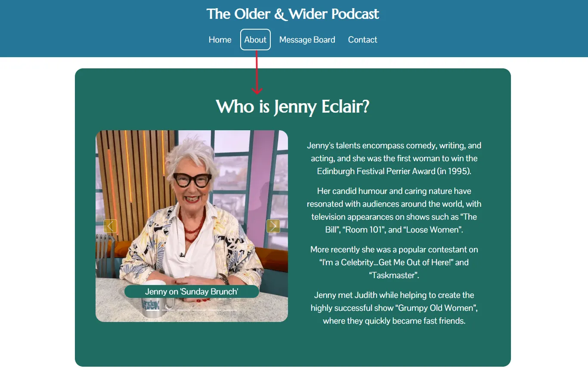

3. "Who is Judith Holder?"

| ITEM | PROCESS | EXPECTED RESULT | ACTUAL RESULT | STATUS |
| --- | --- | --- | --- | --- |
| About page | Navigate to the about page using the navigation bar at the top of each page, and scroll down to the section called "Who is Judith Holder?" | View information about Judith Holder | View information about Judith Holder | PASS | 

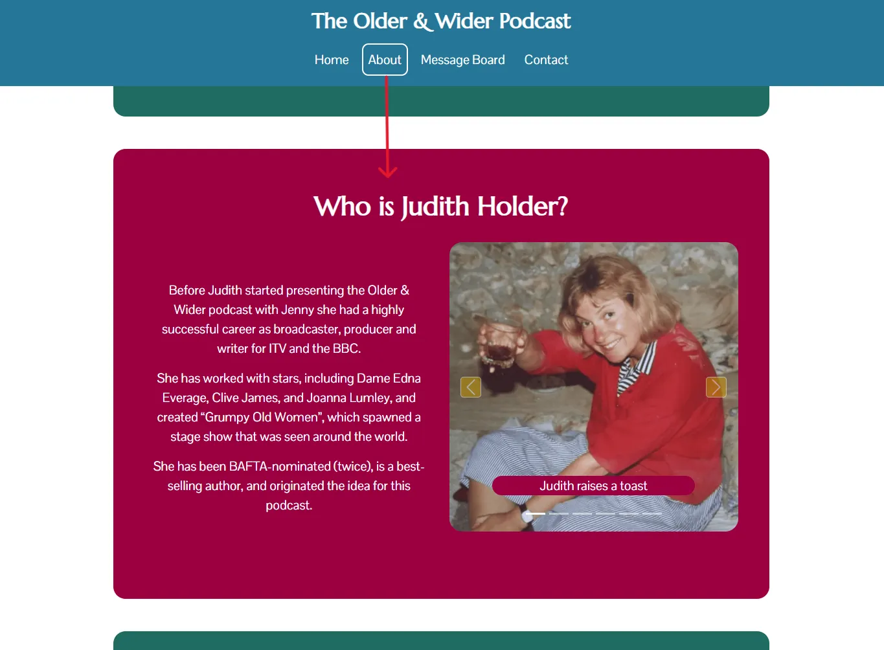

4. "Where can I listen to the Older and Wider Podcast"

| ITEM | PROCESS | EXPECTED RESULT | ACTUAL RESULT | STATUS |
| --- | --- | --- | --- | --- |
| Home page | Navigate to the home page, , scroll down to the section called "Join the Older & Wider Podcast Gang", and find the links to podcast platforms | Find the info and choose a provider where you can download and listen to the podcast | Find the info and choose a provider where you can download and listen to the podcast | PASS | 
| Home page | Navigate to the home page, scroll down to the section called "Listen to the Podcast", and play the latest episode from the embedded podcast player | Find the podcast player and listen to the latest episode | Find the podcast player and listen to the latest episode | PASS | 


5. "When are episodes of the Older and Wider podcast released?"

| ITEM | PROCESS | EXPECTED RESULT | ACTUAL RESULT | STATUS |
| --- | --- | --- | --- | --- |
| Home page | Navigate to the home page, scroll down to the section called "Join the Older & Wider Podcast Gang", and read about the podcast release date | Find the release date of the podcast | Find the release date of the podcast | PASS | 


### Returning Visitor Goals:

1. "I want to find out more background information about the Older and Wider podcast"

| ITEM | PROCESS | EXPECTED RESULT | ACTUAL RESULT | STATUS |
| --- | --- | --- | --- | --- |
| About page | Navigate to the about page using the navigation bar at the top of each page, and scroll down to the section called "What is Older & Wider?" | View information about the podcast | View information about the podcast | PASS |
| Home page | Navigate to the home page, scroll down to the section called "Mailing List", enter a valid email address, and click the button titled 'Send' to be included on the podcast's mailing list | User is added to the mailing list, and will receive further information via email | User is added to the mailing list, and will receive further information via email | REMOVED (the redesign removed the mailing list form) | 


2. "What was mentioned during the 'Culture Corner' segment of this week's show?"

| ITEM | PROCESS | EXPECTED RESULT | ACTUAL RESULT | STATUS |
| --- | --- | --- | --- | --- |
| Message board page | Navigate to the message board page, using the navigation bar at the top of each page, and scroll through the posts on Instagram to find the latest Culture Corner update | Find the latest Culture Corner post and read it | Find the latest Culture Corner post and read it | PASS | 


3. "Has the podcast won any awards?"

| ITEM | PROCESS | EXPECTED RESULT | ACTUAL RESULT | STATUS |
| --- | --- | --- | --- | --- |
| Home page | Navigate to the home page, scroll down to the section called "Join the Older & Wider Podcast Gang", and read about awards for which the podcast has been nominated | Find information about awards | Find information about awards | PASS |

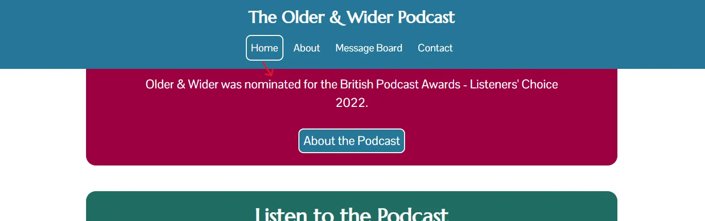

4. "What is the 'Message Board' - it was mentioned by Jenny and Judith in this week's episode, but where can I access it?"

| ITEM | PROCESS | EXPECTED RESULT | ACTUAL RESULT | STATUS |
| --- | --- | --- | --- | --- |
| Message board page | Navigate to the message board page, and read the text under the Instagram embed | Find information about the message board | Find information about the message board | PASS | 

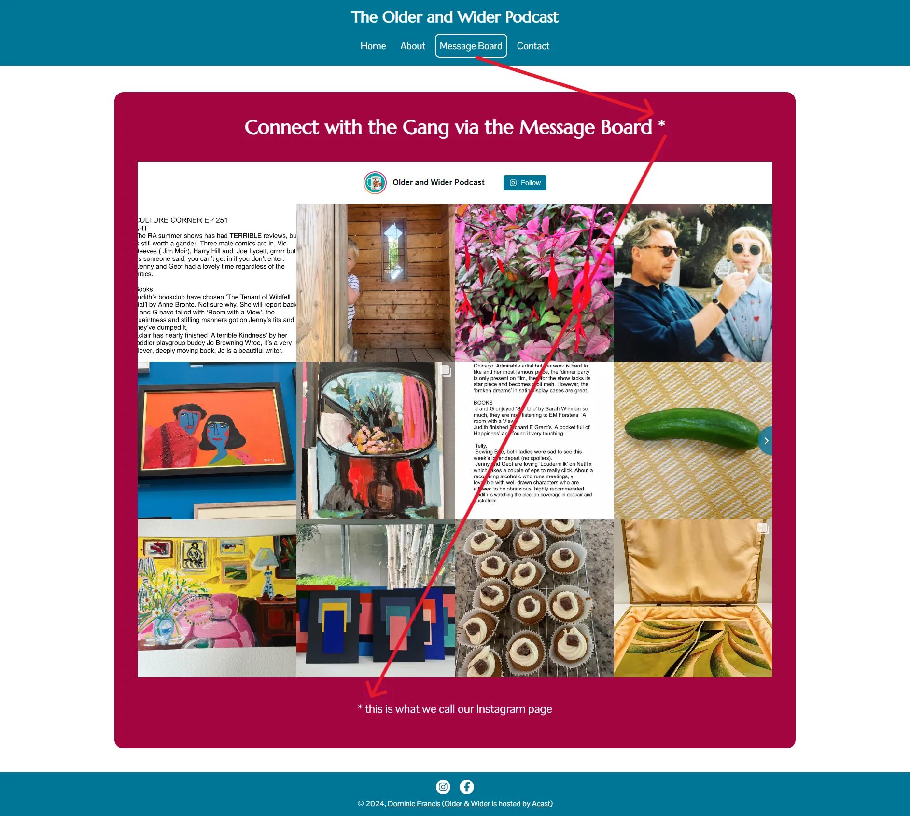

### Frequent Visitor Goals:

1. "How can I contact Jenny and Judith to share my experiences, or comment on an item that was mentioned in the show?"

| ITEM | PROCESS | EXPECTED RESULT | ACTUAL RESULT | STATUS |
| --- | --- | --- | --- | --- |
| Contact page | Navigate to the contact page, and complete the contact form to send a message to the podcast | A message is sent, and the user is redirected to the contact completion page | A message is sent, and the user is redirected to the contact completion page | REMOVED (the redesign removed the contact page) | 

The message board page now answers this goal. It links to the Instagram and Facebook pages of the podcast. To be re-run on the new design.


2. "Is there any podcast merchandise available?"

| ITEM | PROCESS | EXPECTED RESULT | ACTUAL RESULT | STATUS |
| --- | --- | --- | --- | --- |
| Home page | Navigate to the home page, scroll down to the section called "Merch", and click the button titled 'See the Merch' to be taken to the merchandise website (in a new tab) | User can purchase merchandise from an external website | User can purchase merchandise from an external website | PASS | 


3. "Can I watch the podcast being performed live?"

| ITEM | PROCESS | EXPECTED RESULT | ACTUAL RESULT | STATUS |
| --- | --- | --- | --- | --- |
| Home page | Navigate to the home page, scroll down to the section called "Older & Wider - Live!", and click the button titled 'Buy Tickets' to be taken to an external ticketing website (in a new tab) | User can purchase available tickets to a live show, from an external website | User can purchase available tickets to a live show, from an external website | PASS | 


## Browser Compatibility

### Results for the new design

The tests ran on 27 November 2026 against the local preview at `http://127.0.0.1:8000`. Each test loaded all five pages at 390 x 844 (phone) and 1440 x 900 (desktop).

| Engine | Browsers | Method | Result |
|---|---|---|---|
| WebKit | Safari on Mac, iPhone and iPad | Playwright 1.49.1, full-page screenshots, phone emulation for 390 px | PASS on all 10 views. No horizontal scroll. No script errors. All images load. |
| Chromium | Chrome, Edge, Opera | The Claude Code browser and Lighthouse 12 | PASS on all pages. |
| Gecko | Firefox | The site owner checked all five pages by hand, at phone width and desktop width. The Playwright Firefox build does not start on this version of macOS. | PASS on all pages. |

Checks in each view:

- The halftone screen shows on the photos.
- The masthead fits the width of the page.
- The bingo ticket shows all 27 cells.
- The consent banner, the Play here button and the footer show correctly.

To do the Firefox test by hand:

1. Start the preview with `python3 -m http.server 8000`.
2. Open each page in Firefox at phone width and at desktop width.
3. Do the four checks above.

### Results for the earlier design

The screenshots below show the earlier design.

The website has been successfully tested in the following browsers (desktop screenshots used to allow for a larger preview, except for Safari as there is no Windows version of that browser):

### Google Chrome


### Microsoft Edge

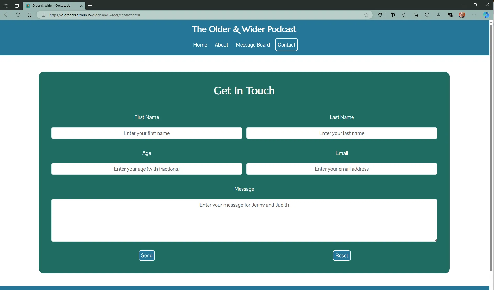

### Firefox


### Opera

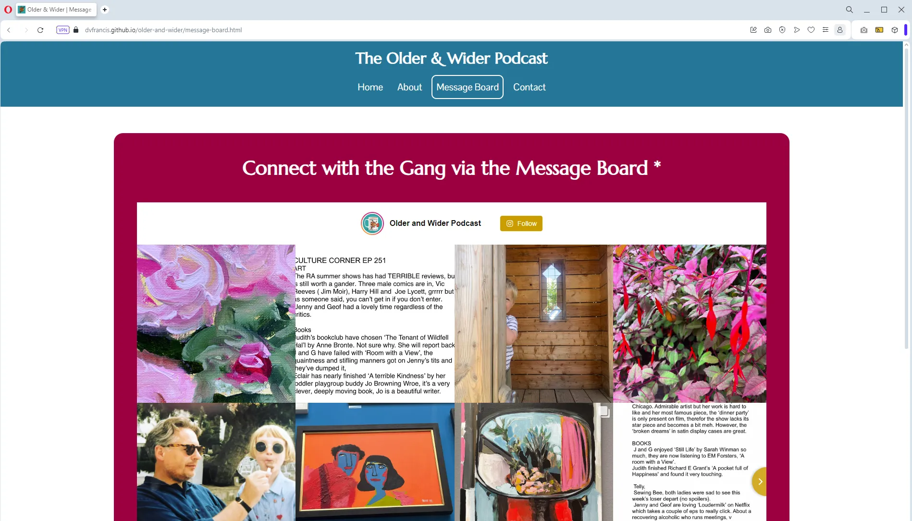

### Safari (on an iPad)

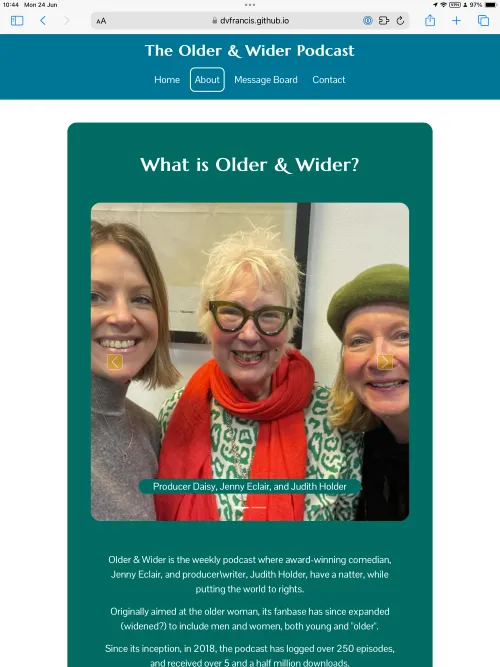

### Safari (on an iPhone)

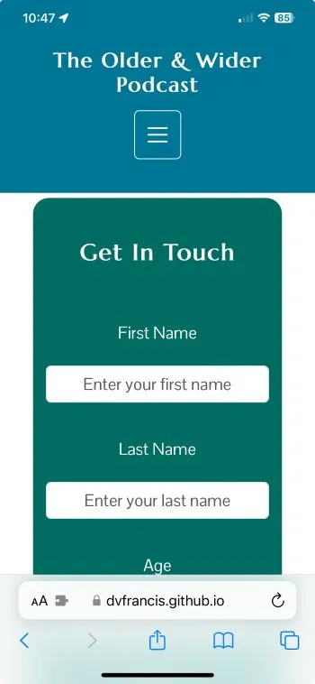

## Accessibility

These results are for the earlier design. To be re-run on the new design. The redesign removed the auto-redirect, so the redirect errors below do not apply to the new `404.html`.

Pages were tested for accessibility using the [Wave Accessibility Evaluation Tool](https://wave.webaim.org):

### index.html


### mailing-list-completion.html (page removed)

The redesign removed this page. These results are kept for the record.

The error being shown here is because of the auto-redirect setup on the page, which is part of the design:


### about.html


### message-board.html

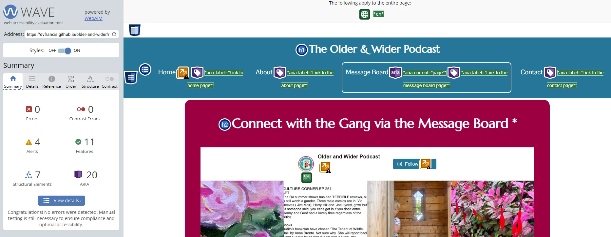

### contact.html (page removed)

The redesign removed this page. These results are kept for the record.

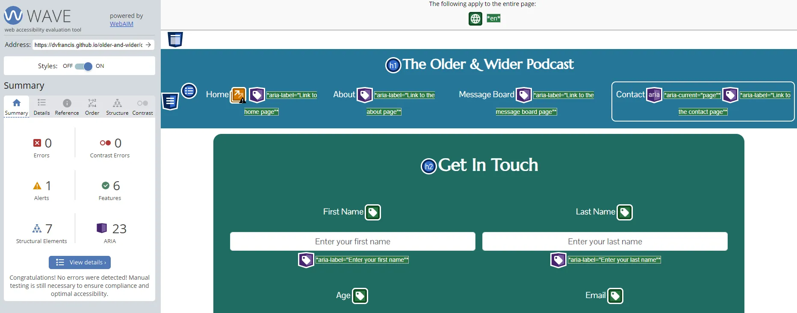

### contact-completion.html (page removed)

The redesign removed this page. These results are kept for the record.

The error being shown here is because of the auto-redirect setup on the page, which is part of the design:


### 404.html

The error being shown here is because of the auto-redirect setup on the page, which is part of the design:


## Responsiveness

These results are for the earlier design. To be re-run on the new design.

Pages were tested for responsiveness at mobile size (Samsung Galaxy S5/S6/S7 - 360px x 640px), tablet size (Apple iPad Retina - 768px 1024px), and desktop size (1400px x 700px), using the [Responsive Web Design Checker](https://responsivedesignchecker.com/):

### index.html

#### Mobile

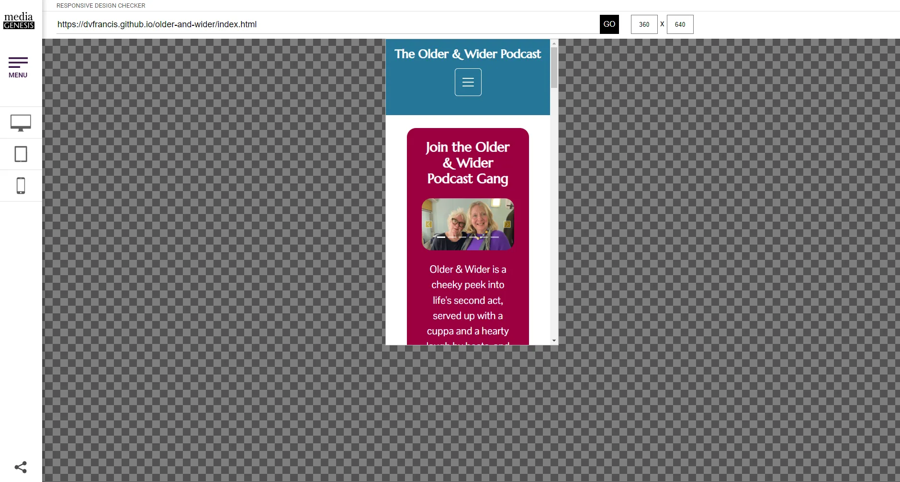

#### Tablet


#### Desktop


### mailing-list-completion.html (page removed)

The redesign removed this page. These results are kept for the record.

#### Mobile


#### Tablet


#### Desktop

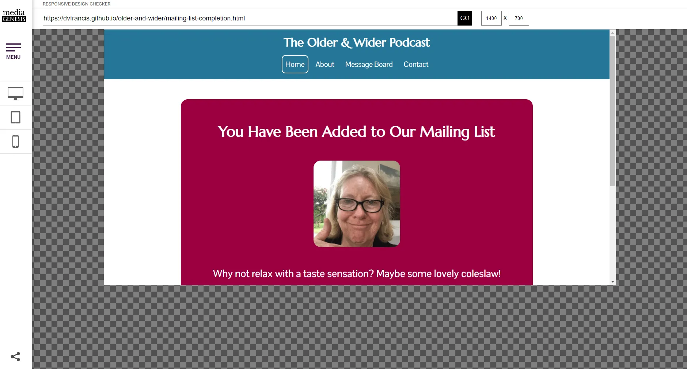

### about.html

#### Mobile


#### Tablet


#### Desktop

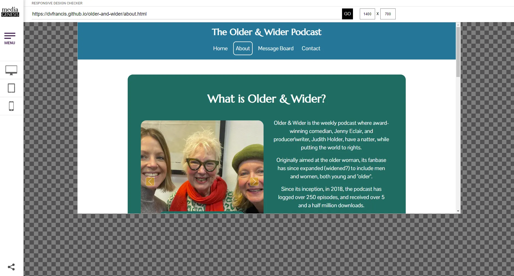

### message-board.html

For some reason, the Instagram widget does not load for this preview, and the social media icons are squashed. This behaviour is not evident when viewing the site on an actual mobile, tablet, or desktop device so I think it is caused by something this website does during testing.

#### Mobile


#### Tablet

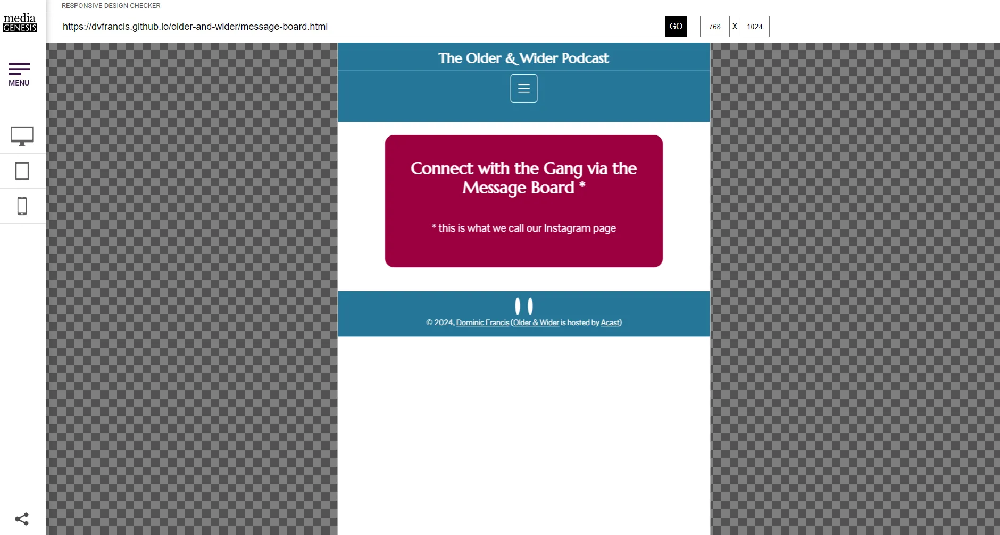

#### Desktop


### contact.html (page removed)

The redesign removed this page. These results are kept for the record.

#### Mobile


#### Tablet


#### Desktop


### contact-completion.html (page removed)

The redesign removed this page. These results are kept for the record.

#### Mobile


#### Tablet


#### Desktop


### 404.html

#### Mobile

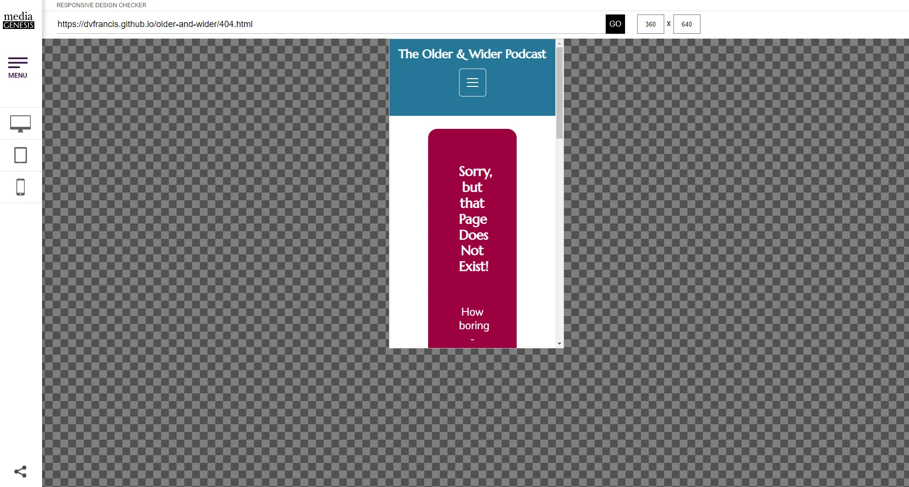

#### Tablet


#### Desktop

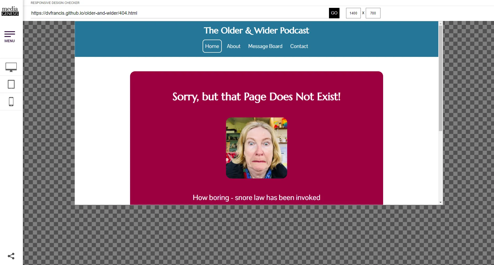

## Performance

### Lighthouse results for the new design

Lighthouse 12 ran on 27 November 2026 in headless Chrome. It tested the local preview at `http://127.0.0.1:8000`.

| Page | Device | Performance | Accessibility | Best Practices | SEO |
|---|---|---|---|---|---|
| `index.html` | Mobile | 95 | 96 | 100 | 100 |
| `index.html` | Desktop | 100 | 100 | 100 | 100 |
| `about.html` | Mobile | 95 | 96 | 100 | 100 |
| `about.html` | Desktop | 100 | 96 | 100 | 100 |
| `message-board.html` | Mobile | 93 | 100 | 100 | 100 |
| `message-board.html` | Desktop | 99 | 100 | 100 | 100 |
| `privacy.html` | Mobile | 92 | 100 | 100 | 100 |
| `privacy.html` | Desktop | 98 | 100 | 100 | 100 |
| `404.html` | Mobile | 92 | 100 | 100 | 66 |
| `404.html` | Desktop | 89 | 100 | 100 | 66 |
| `live-shows.html` | Mobile | 98 | 100 | 100 | 100 |
| `live-shows.html` | Desktop | 100 | 100 | 100 | 100 |
| `archive.html` | Mobile | 98 | 100 | 100 | 100 |
| `archive.html` | Desktop | 100 | 100 | 100 | 100 |

Notes on the scores below 100:

- **Accessibility 96.** The colour contrast audit fails on the word AND in the masthead. The word is magenta on pink. It is part of the logotype. WCAG 1.4.3 does not apply contrast rules to logotypes.
- **SEO 66 on `404.html`.** The page has a `noindex` tag. Lighthouse marks the page as not crawlable. This is correct for an error page.
- **Performance.** The first run gave a layout shift of 0.209 on `index.html` and 0.316 on `about.html` on desktop. The cause was the fonts from Google Fonts. The site now hosts the fonts and preloads them. The second run gave a layout shift of 0 on `index.html` and 0.018 on `about.html`. The scores in the table are from the second run for these two pages.
- **`live-shows.html` and `archive.html`.** Lighthouse 12 tested the live site on 28 November 2026, after the venues, links and covers were added. The first mobile run of `live-shows.html` ran immediately after a deploy. It gave 79, with a layout shift of 0.199. Three more runs each gave 98 and a layout shift of 0. The table shows the later runs. Two runs of `archive.html` gave the same scores.

### Lighthouse results for the earlier design

The scores below are for the earlier design. The notes about the redirect do not apply to the new `404.html`, because the redesign removed the redirect.

Each page was audited using [Google Lighthouse](https://developer.chrome.com/docs/lighthouse/), for both mobile and desktop:

### index.html

#### Mobile

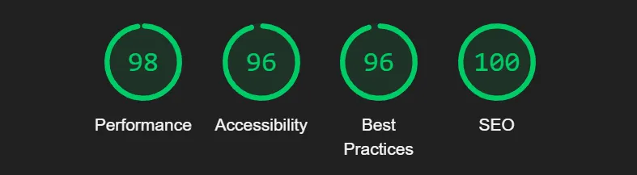

#### Desktop


### mailing-list-completion.html (page removed)

The redesign removed this page. These results are kept for the record.

The lower score for accessibility here is caused by two things - the presence of the redirect (which is part of the site design), and because FontAwesome automatically adds the ``aria-hidden="true"`` class to all of its icons. This cannot be stopped and is conflicting with my own ARIA label on each social media icon. 

#### Mobile


#### Desktop


### about.html

#### Mobile


#### Desktop

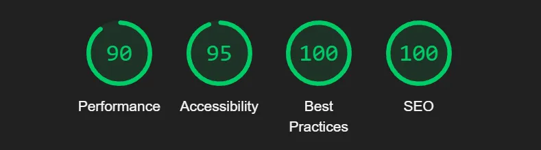

### message-board.html

The lower score for performance here is because, among other things, the images being loaded by the Instagram embed are quite large. Unfortunately, I have no control over this. 

#### Mobile

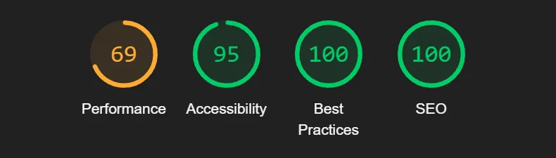

#### Desktop


### contact.html (page removed)

The redesign removed this page. These results are kept for the record.

#### Mobile


#### Desktop

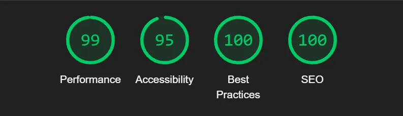

### contact-completion.html (page removed)

The redesign removed this page. These results are kept for the record.

The lower score for accessibility here is caused by two things - the presence of the redirect (which is part of the site design), and because FontAwesome automatically adds the ``aria-hidden="true"`` class to all of its icons. This cannot be stopped and is conflicting with my own ARIA label on each social media icon. 

#### Mobile


#### Desktop


### 404.html

The lower score for accessibility here is caused by two things - the presence of the redirect (which is part of the site design), and because FontAwesome automatically adds the ``aria-hidden="true"`` class to all of its icons. This cannot be stopped and is conflicting with my own ARIA label on each social media icon. 

#### Mobile


#### Desktop


## Bugs

These bugs were found in the earlier design. Some of them relate to Bootstrap or to the contact page, which the redesign removed.

Here is a list of bugs encountered while building this website. Images shown illustrate the original problem:

### Bug 1


| Bug | Fix |
| --- | --- |
| The Fontawesome logos are not centred | Replace original code with Bootstrap classes to organise the icons into rows and columns before applying text-end and text-start to achieve final position |

### Bug 2


| Bug | Fix |
| --- | --- |
| The link to the currently loaded page is not highlighted in the navigation bar | Style the pseudo elements - :link, :hover, and :active - to change the navigation links upon use. Add a class called "active" (with the same CSS declarations as :hover) and add to the menu item for the currently active page.

### Bug 3


| Bug | Fix |
| --- | --- |
| Navigation bar is not centred or responsive | Centred the menu items using the mx-auto Bootstrap class on the internal navbar container

### Bug 4


| Bug | Fix |
| --- | --- |
| Page content is hidden behind fixed header | Created media queries to add padding to the top of the ``body`` element, at different screen resolutions

### Bug 5

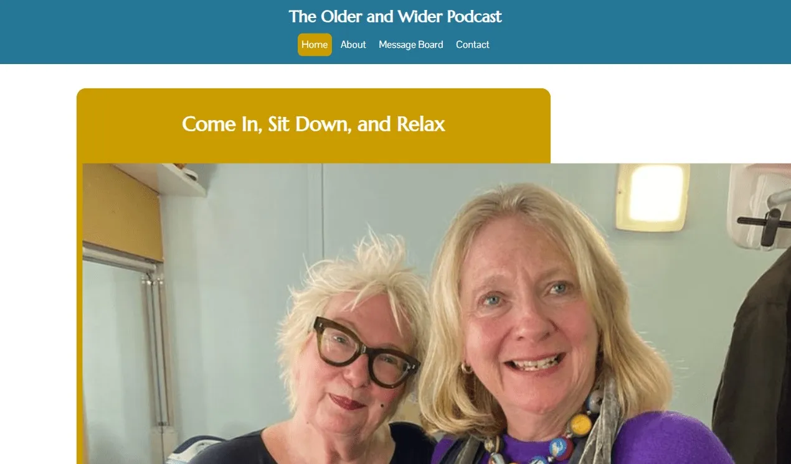

| Bug | Fix |
| --- | --- |
| Images are too wide at larger resolution | Adjusted the size using a percentage value against ``max-width`` property of the img tag |

### Bug 6

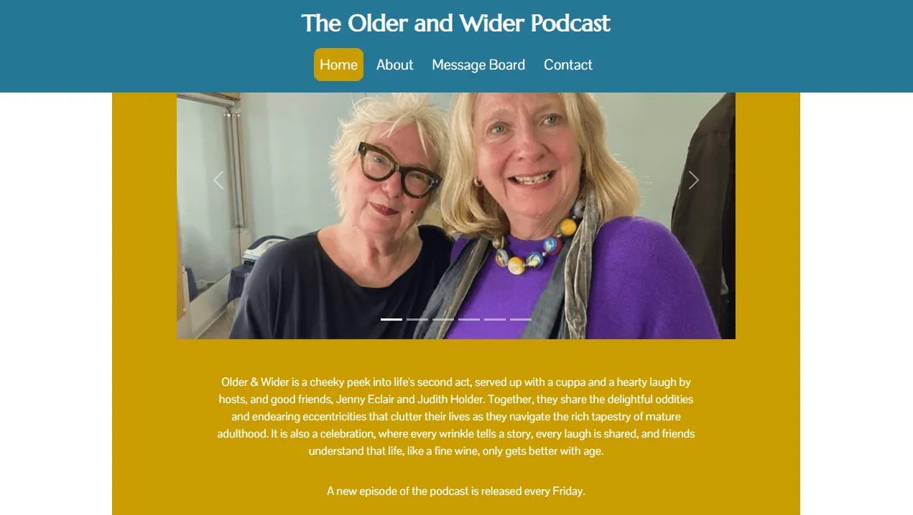

| Bug | Fix |
| --- | --- |
| Text is too small at larger screen resolutions | Added Bootstrap classes to manage the text elements at different screen resolutions; for example, fs-4. |

### Bug 7


| Bug | Fix |
| --- | --- |
| Contact form is to wide on larger screen resolutions | Needed some adjustment with regards to font size and font weight, using Bootstrap font classes |

### Bug 8


| Bug | Fix |
| --- | --- |
| A red line appears underneath the header on the contact.html page, at higher screen resolutions | Accidentally added the ``.feature`` class to the header, which added the red line |

### Bug 9


| Bug | Fix |
| --- | --- |
| If you select a navigation link but then drag away from it, it turns black | The pseudo element ``:visited`` had not been formatted for the links. Once it was they remained white as expected. |

### Bug 10


| Bug | Fix |
| --- | --- |
| When the site width increases, the padding on buttons seems to increase too, leading to misaligned button text | Removed the height property that had been added to the buttons |

### Bug 11

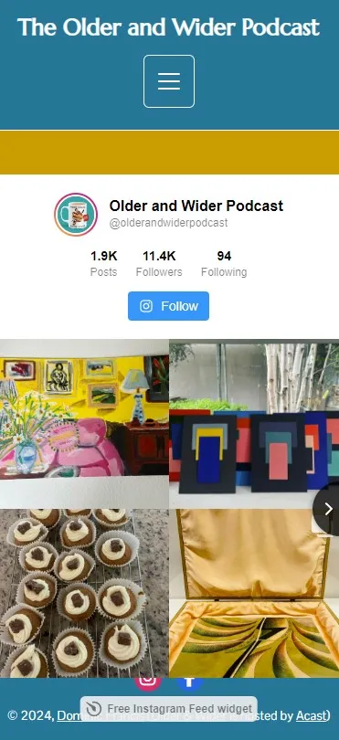

| Bug | Fix |
| --- | --- |
| The Instagram widget used for message-board.html overlaps the fixed footer | The footer is no longer fixed and this solved the issue. If it had remained fixed I believe adjusting the z-index of the widget would also have solved the issue. |

### Bug 12

.webp)
.webp)
.webp)
.webp)

| Bug | Fix |
| --- | --- |
| When I hover over, or click, a navbar link, the other navbar links move ever so slightly (I have exaggerated it for the screenshots so it is easier to see) | Added a default border size to the item when it wasn't being hovered over or clicked. |

## Unfixed Bugs

Here is a list of bugs I was unable to fix due to circumstances beyond my control:

### Bug 1


| Bug | Fix |
| --- | --- |
| There is a white line beneath the footer | This only occurs in Chromium-based browsers such as Google Chrome and Microsoft Edge; the line does not appear in other browers tested. After discussing this with Code Institute's tutor support we came to the conclusion it was either a problem with that type of browser, or a strange quirk of the computer I am using |